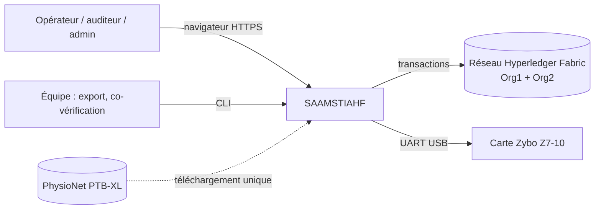
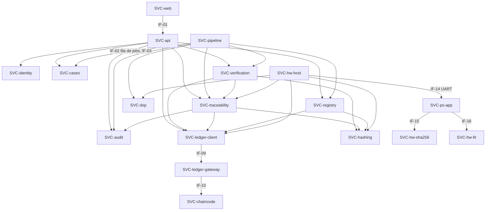
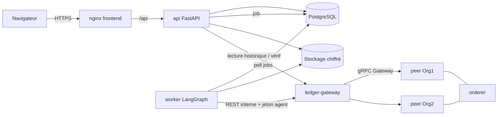
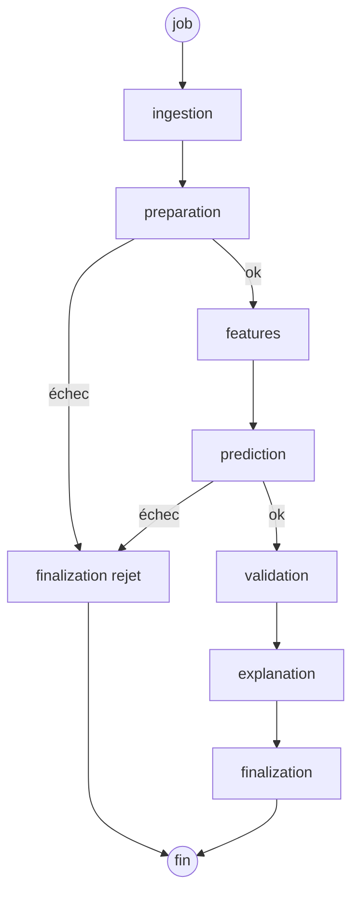

# SAAMSTIAHF — Architecture

| Owner | Reviewers | Status | Version | Last updated | Suite version | PRD | TRD | Schema | System Design |
|---|---|---|---|---|---|---|---|---|---|
| Équipe projet (L) | Encadrant `[TBD: nom, Q-12]` | In review | 1.0.1 | 2026-10-23 | 2.0.1 | [01-prd.md](01-prd.md) | [02-trd.md](02-trd.md) | [04-backend-schema.md](04-backend-schema.md) | [05-system-design.md](05-system-design.md) |

Ce document est né de la suite v2.0.0 : il reprend le contenu architectural de l'ancien TRD v1.1.0 (§6 et §20). Les identifiants ADR-01 à ADR-14 sont conservés à l'identique.

## 1. Objet et périmètre

Couvre la structure du prototype v1 : composants logiciels (Python, TypeScript, React), registre Hyperledger Fabric, volet matériel (Zybo Z7-10) et outils de co-vérification ; frontières, interfaces internes, propriété des données et décisions (ADR). Ne couvre pas : choix de stack et cibles NFR (TRD), charge, capacité et pannes (System Design), tables détaillées (Schema).

## 2. Moteurs d'architecture

| Rang | Moteur | Source |
|---|---|---|
| 1 | Toute modification d'un artefact est détectée ; logiciel et matériel donnent des résultats identiques bit à bit | NFR-08, NFR-16 |
| 2 | Aucune donnée médicale ni identifiant sur la chaîne ; artefacts chiffrés ; accès par rôle | NFR-03, NFR-04, NFR-05 |
| 3 | Traçabilité et reproductibilité : parent de chaque artefact, versions enregistrées, hachage déterministe, journal des agents, build matériel par script | NFR-06, NFR-07, NFR-12, NFR-14, NFR-19 |
| 4 | Délai : 4 personnes, plan recalé du 2026-10-23 au 2026-11-30 | PRD §12, D-17 |
| 5 | Démontrabilité en soutenance, y compris l'étape 9 sur carte | D-13, CDC §9 |
| 6 | Performance de démonstration (pipeline, vérification, lecture, PL, étape 9) | NFR-01, NFR-02, NFR-15, NFR-17, NFR-20 |
| 7 | Modularité : IA, validation, stockage et registre remplaçables | NFR-13 |

En cas de conflit, le rang le plus haut l'emporte ; chaque ADR cite les moteurs qu'il sert.

## 3. Contexte du système



| Système externe | Entrée / sortie |
|---|---|
| Réseau Fabric (test-network, 2 organisations) | Reçoit les enregistrements `ARTIFACT` et `MODEL` ; renvoie empreintes et historique |
| Carte Zybo Z7-10 | Reçoit des manifestes et des dérivations ; renvoie condensats et sorties FIR (hors ligne, D-11) |
| PhysioNet PTB-XL | Jeu de données téléchargé une fois (entraînement, vecteurs de test) |

## 4. Style architectural

**Monolithe modulaire Python** déployé en deux processus (`api`, `worker`) qui partagent des modules de domaine, plus trois éléments imposés hors Python : la passerelle Fabric en TypeScript (ADR-02), le chaincode (Fabric) et le volet matériel (VHDL + C). Chaque table a un seul module propriétaire, même si deux processus le chargent (ADR-15). Le matériel reste hors du chemin critique (ADR-16).

## 5. Composants



| ID | Component | Responsabilité (une phrase) | Owns data | Exposes | Depends on | Runs as | Owner |
|---|---|---|---|---|---|---|---|
| SVC-web | Interface web | Affiche les écrans S-01 à S-12 en français | — | — | IF-01 | Fichiers statiques servis par nginx | F |
| SVC-api | API HTTP | Traduit les requêtes REST en appels de modules, avec contrôle de rôle | — | IF-01 | SVC-identity, SVC-cases, SVC-registry, SVC-traceability, SVC-verification, SVC-audit, SVC-ledger-client | Processus `api` | B |
| SVC-identity | Identité | Gère comptes, sessions et verrouillage | E-users, E-refresh_tokens, E-login_attempts | IF-11 | — | Module du processus `api` | B |
| SVC-cases | Cas | Gère le cycle de vie d'un cas et sa file de jobs | E-cases, E-jobs | IF-02, IF-03 | — | Module des processus `api` et `worker` | B |
| SVC-registry | Registre de versions | Fournit le modèle et la config de validation actifs | E-models, E-validation_configs | IF-12 | SVC-ledger-client, SVC-hashing | Module des processus `api`, `worker` et du script `registry.py` | I |
| SVC-pipeline | Pipeline agentique | Orchestre les 7 agents LangGraph d'un job | E-agent_logs, checkpoints LangGraph | — | SVC-cases, SVC-registry, SVC-traceability, SVC-verification, SVC-dsp, SVC-audit | Processus `worker` | I (agents IA), B (graphe) |
| SVC-traceability | Traçabilité | Stocke, hache et ancre chaque artefact, puis le relit vérifié | E-artifacts, E-artifact_files, volume `/data/artifacts` | IF-04 | SVC-hashing, SVC-ledger-client, SVC-audit | Module des processus `api` (lecture) et `worker` | B |
| SVC-verification | Vérification | Compare les empreintes recalculées au registre Fabric | E-verifications, E-verification_items | IF-08 | SVC-traceability, SVC-hashing, SVC-ledger-client | Module des processus `api` et `worker` (R5) | B |
| SVC-audit | Audit | Ajoute les événements applicatifs au journal | E-audit_events | IF-13 | — | Module des processus `api` et `worker` | B |
| SVC-hashing | Hachage | Canonise un manifeste et calcule son SHA-256 | — | IF-05 | — | Bibliothèque `saam.hashing` | B |
| SVC-dsp | Traitement du signal | Fournit le modèle FIR bit-exact et la préparation du signal | `fir_coeffs.json` (fichier généré) | IF-06 | — | Bibliothèque `saam.dsp` | I |
| SVC-ledger-client | Client registre | Appelle la passerelle Fabric avec le jeton de l'agent | — | IF-07 | IF-09 | Bibliothèque `saam.ledger` | B |
| SVC-ledger-gateway | Passerelle Fabric | Signe les transactions avec l'identité Fabric de l'appelant | Wallet Fabric (lecture seule) | IF-09 | IF-10 | Processus Node `ledger-gateway` | L |
| SVC-chaincode | Chaincode `provenance` | Enregistre empreintes et provenance de façon immuable | E-ledger_artifact, E-ledger_model | IF-10 | — | Chaincode sur les peers Org1 et Org2 | L |
| SVC-hw-sha256 | Cœur SHA-256 | Calcule un SHA-256 en logique programmable | — | IF-15 | — | PL du XC7Z010 | L |
| SVC-hw-fir | Cœur FIR | Filtre et décime une dérivation int16 en logique programmable | — | IF-16 | — | PL du XC7Z010 | L |
| SVC-ps-app | Application PS | Relaie les commandes UART vers les cœurs PL | — | IF-14 | IF-15, IF-16 | Bare-metal C sur le PS ARM | L |
| SVC-hw-host | Outils de co-vérification | Exporte les vecteurs d'un cas et compare carte ou simulation aux références | `hw/vectors/cases/`, `hw/reports/` | — | SVC-traceability, SVC-hashing, SVC-dsp, SVC-ledger-client, IF-14 | CLI Python sur le PC | B (export, simulation), I (carte, démo) |

Unités déployables : 7 (web, api, worker, ledger-gateway, chaincode, image Zybo, CLI hôte). Justification : `api`/`worker` séparés pour les jobs longs (ADR-03) ; passerelle imposée par l'absence de SDK Python (ADR-02) ; chaincode et image Zybo imposés par le sujet et D-10 ; tout le reste partage un seul paquet Python pour une équipe de 4.

### 5.1 Vue d'ensemble (processus)



### 5.2 Graphe d'agents (LangGraph) — SVC-pipeline

État partagé `CaseState` : `case_id`, `artifacts{type → artifact_id}`, `step`, `status`, `errors[]`, `quality`, `prediction`, `validation`.



- L'**orchestrateur** est le graphe lui-même : arêtes conditionnelles sur `state.status` (AC-08.1, AC-08.2). Pas de LLM en P0 : routage déterministe.
- Chaque nœud-agent : (1) lit ses entrées via IF-04 en vérifiant leur empreinte, (2) produit son artefact, (3) appelle `TraceabilityTool.record(artifact)` = stocker → hacher → ancrer sous l'identité de l'agent, (4) écrit une entrée `E-agent_logs` (AC-08.3).
- Checkpoints LangGraph dans PostgreSQL (`langgraph-checkpoint-postgres`) : un job interrompu reprend à la dernière étape ancrée.

### 5.3 Détail des étapes

| Agent | Entrée | Sortie (artefact) | Notes |
|---|---|---|---|
| `ingestion` | fichiers téléversés | `original` | Lecture WFDB (`.hea`/`.dat`) ou CSV (12 colonnes I…V6, fréquence en paramètre). Suppression des commentaires d'en-tête WFDB et métadonnées patient ; rapport : remplacement des noms propres détectés (regex + liste) par `[ANONYMISÉ]`. |
| `preparation` | `original` | `processed` | (1) Vérif format/fréquence/durée (≥ 10 s), NaN/saturation, `quality_score` ∈ [0,1] (part d'échantillons valides, min des dérivations). (2) Quantification : signal en mV → rééchantillonnage `resample_poly` vers 500 Hz si fe ≠ 500 → `int16 = sat(rint(mV × 1000))` (pour PTB-XL `records500`, gain 1000 à 500 Hz, on retrouve exactement les valeurs brutes) ; les 10 premières secondes → `fir_input.npy` int16 [12, 5000]. (3) **Étage FIR bit-exact** `saam/dsp/fir_fixed.py` (§5.6) sur les 10 premières secondes (5 000 échantillons + 55 zéros) → `fir_stage.npy` int16 [12, 1011] (sortie causale brute, comparée au VHDL). (4) Alignement : suppression des 11 premières sorties → [12, 1000] à 100 Hz. (5) Passe-haut Butterworth ordre 2 à 0,5 Hz, zéro-phase (`sosfiltfilt`), en flottant. (6) z-score par dérivation. Le notch 50 Hz de la v1.0.0 est supprimé : la bande atténuée du FIR (≥ 40 dB dès 50 Hz) le couvre. Rapport de traitement JSON (paramètres, `fir_coef_id`). |
| `features` | `processed` | `features` | Tenseur d'entrée `float32[12,1000]` + mesures interprétables (FC, RR moyen/écart-type via neurokit2, amplitude par dérivation). |
| `prediction` | `features` | `prediction` | Vérifie l'empreinte du fichier modèle contre l'enregistrement `MODEL` on-chain (AC-04.3). Probabilités sigmoïdes NORM, MI, STTC, CD, HYP ; classe principale = argmax. |
| `validation` | tous les ancêtres | `validation` | Règles §5.4. |
| `explanation` | `prediction`, `validation` | `explanation` | Gabarit FR (AC-06.1). F-16 (saillance, P1) non planifiée en v1 (D-17). F-17 (rédaction LLM, P2) désactivée par défaut. |
| `finalization` | `validation`, `explanation` | `final_result` | Décision + mention « prototype — pas un diagnostic médical ». En cas de rejet anticipé, parent = dernier artefact produit. |

### 5.4 Règles de validation

Seuils dans `E-validation_configs` (versionnés ; la version est incluse dans l'artefact `validation`).

| Règle | Mesure | ok | échec → | Défaut |
|---|---|---|---|---|
| R1 Confiance | max des probabilités | ≥ `conf_high` | Révision requise | `conf_high` = 0,70 |
| R2 Qualité | `quality_score` | ≥ `quality_min` | Révision requise | `quality_min` = 0,90 (≡ ≤ 10 % invalides, AC-03.2) |
| R3 Cohérence | termes du rapport → superclasses attendues ; classe prédite ∈ attendues ou NORM attendu & prédit | compatible | Révision requise ; `non_applicable` si aucun terme / pas de rapport | Lexique `config/lexicon.yaml` (FR/DE/EN) |
| R4 Complétude | présence des artefacts `original`, `processed`, `features`, `prediction` | tous présents | Rejeté | — |
| R5 Intégrité | re-vérification des ancêtres (§5.5, sans persistance) | tous `valide` | Rejeté | — |

Décision : Rejeté si R4 ou R5 échoue ; sinon Révision requise si R1, R2 ou R3 échoue ; sinon Accepté pour le prototype.

### 5.5 Vérification d'intégrité — SVC-verification

Pour chaque artefact du cas : lire l'enregistrement Fabric (`GetArtifactRecord`) ; Fabric injoignable ou absent → `non_vérifiable` ; fichier(s) hors chaîne absent(s) → `manquant` ; déchiffrement en échec (tag GCM invalide) ou SHA-256 recalculé ≠ empreinte on-chain → `modifié` ; sinon `valide`. Résultat persisté dans `E-verifications` (AC-10.3) quand l'appel vient de SVC-api ; non persisté pour R5.

### 5.6 Volet matériel VHDL (F-18, F-19, F-20)

Principe : le matériel est une **seconde implémentation** de deux maillons du pipeline, vérifiée hors ligne. Le pipeline n'appelle jamais la carte (D-11, ADR-16) ; il utilise les modèles de référence Python, qui sont aussi les oracles des tests VHDL — une seule source de vérité.

```mermaid
flowchart LR
  subgraph PC
    EXP[scripts/export_hw_vectors.py<br/>admin, clé ARTIFACT_KEY] --> VEC[(hw/vectors/cases/…)]
    VEC --> CV[hw/host/coverify.py]
    REF[saam/hashing · saam/dsp/fir_fixed.py] --> CV
    LG[ledger-gateway<br/>empreintes on-chain] --> CV
    CV --> REP[(hw/reports/*.md, *.json)]
  end
  CV -->|--target sim| SIM[cocotb + GHDL<br/>hw/sim]
  CV -->|--target board, UART| PS
  subgraph Zybo Z7-10 · XC7Z010
    PS[PS ARM : app bare-metal C<br/>protocole UART] -->|AXI4-Lite| SHA[sha256_axi]
    PS -->|AXI4-Lite| FIR[fir_axi]
  end
```

#### Arborescence `hw/`

`hw/rtl/` (VHDL synthétisable), `hw/gen/` (générateurs : `gen_fir_coeffs.py` → `saam/dsp/fir_coeffs.json` + `hw/rtl/fir_coeffs_pkg.vhd`), `hw/sim/` (tests cocotb, Makefile GHDL), `hw/vivado/build.tcl` (projet, block design, bitstream, XSA, rapports), `hw/ps_app/` (application Vitis bare-metal), `hw/host/` (`zybo_client.py`, `coverify.py`, `demo_step.py`), `hw/vectors/` (`ptbxl/` : 5 enregistrements publics versionnés ; `cases/` : exports de cas, ignorés par git), `hw/reports/` (rapports de co-vérification, utilisation, timing).

#### Conventions VHDL

VHDL-2008, `ieee.numeric_std` uniquement, une seule horloge (FCLK_CLK0 = 100 MHz depuis le PS), reset synchrone actif bas (`aresetn`, convention AXI), aucune primitive constructeur dans les cœurs (DSP/BRAM inférés) pour rester simulables par GHDL ; seul le block design Vivado est spécifique au Zynq.

#### Cœur SHA-256 (F-18) — SVC-hw-sha256, IF-15

- `sha256_core` : FIPS 180-4, itératif, 1 ronde par cycle (64 cycles de compression par bloc de 512 bits + quelques cycles de chargement/addition), planification des mots W sur un registre à décalage de 16 mots.
- `sha256_padder` : bourrage FIPS en matériel (bit `1`, zéros, longueur sur 64 bits) à partir d'un flux de mots de 32 bits gros-boutistes et du nombre d'octets valides du dernier mot ; messages de 0 à 2^32 − 1 octets.
- `sha256_axi` (AXI4-Lite esclave, 32 bits) :

| Offset | Registre | Accès | Description |
|---|---|---|---|
| 0x00 | CTRL | W | bit0 `INIT` (nouveau message, auto-effacé) ; bit1 `FINAL` (le dernier mot vient d'être écrit) |
| 0x04 | STATUS | R | bit0 `READY` (peut recevoir un mot) ; bit1 `BUSY` ; bit2 `DONE` (condensat valide) |
| 0x08 | DATA_IN | W | mot de 32 bits, premier octet du message dans les bits 31..24 |
| 0x0C | LAST_BYTES | W | octets valides du dernier mot (0–4 ; 0 pour un message vide) |
| 0x10–0x2C | DIGEST0–7 | R | H0…H7 (DIGEST0 = 4 premiers octets du condensat) |
| 0x30 | VERSION | R | 32 premiers bits du SHA git du build matériel |

#### Filtre FIR + décimation (F-19) — SVC-hw-fir, IF-16

- **Gabarit (AC-16.1) :** fe = 500 Hz, bande passante 0–40 Hz (ondulation ≤ 0,5 dB), bande atténuée ≥ 50 Hz (≥ 40 dB), décimation ×5 → 100 Hz.
- **Conception (vérifiée le 2026-10-06, `scipy.signal.remez`, poids 1:10) :** 111 coefficients symétriques, quantifiés en Q1.15 (`rint(h × 2^15)`) → ondulation 0,379 dB, atténuation 52,6 dB après quantification. 101 coefficients ne suffisent pas (ondulation 0,528 dB). Retard de groupe 55 échantillons d'entrée = 11 de sortie.
- **Arithmétique bit-exacte (contrat partagé VHDL ↔ `fir_fixed.py`, IF-06) :**
  - entrée `x` int16 ; état initial nul (`x[n<0] = 0`), remis à zéro entre deux dérivations ;
  - sortie `y[m] = sat16((Σ_{k=0}^{110} q[k]·x[5m−k] + 2^14) >> 15)`, pour `m = 0, 1, …` (une sortie aux entrées d'indice 0, 5, 10…) ; `>>` = décalage arithmétique (arrondi au plus proche, moitiés vers +∞) ; `sat16` = saturation à [−32 768, 32 767] ;
  - Σ|q| = 62 379 → |acc| ≤ 2 044 035 072 < 2^31 : un accumulateur signé de 32 bits suffit ; le VHDL utilise 40 bits (aucun débordement, identique à l'entier Python) ; la saturation est atteignable (AC-16.4).
- **Architecture :** une seule MAC séquentielle (≤ 111 cycles par sortie, largement suffisant), ligne à retard de 111 échantillons en RAM inférée, coefficients en ROM depuis `fir_coeffs_pkg.vhd` (généré, jamais édité à la main).
- **Identifiant des coefficients :** `fir_coef_id` = 8 premiers caractères hexadécimaux du SHA-256 de `fir_coeffs.json` (JCS) ; enregistré dans le manifeste `processed` et lisible dans le registre COEF_ID.
- `fir_axi` (AXI4-Lite esclave, 32 bits) :

| Offset | Registre | Accès | Description |
|---|---|---|---|
| 0x00 | CTRL | W | bit0 `CLEAR` (vide la ligne à retard et le compteur de phase, auto-effacé) |
| 0x04 | STATUS | R | bit0 `IN_READY` ; bit1 `OUT_VALID` |
| 0x08 | DATA_IN | W | échantillon int16 (bits 15..0) |
| 0x0C | DATA_OUT | R | sortie int16 étendue en signe ; la lecture consomme la sortie |
| 0x10 | COEF_ID | R | `fir_coef_id` sur 32 bits |
| 0x14 | VERSION | R | 32 premiers bits du SHA git du build matériel |

#### Intégration Zynq (ADR-13) — SVC-ps-app, IF-14

- Block design (`hw/vivado/build.tcl`) : `processing_system7` (préréglage Zybo Z7-10 des fichiers de carte Digilent), interconnexion AXI, `sha256_axi` et `fir_axi` ; FCLK_CLK0 100 MHz ; génération du bitstream, export XSA, rapports d'utilisation et de timing copiés dans `hw/reports/`.
- Application PS (`hw/ps_app/`, Vitis, bare-metal C) : boucle de commandes sur l'UART de la carte.
- Protocole UART (115 200 bauds par défaut ; 921 600 visé `[à valider en T1.9]`) : trame `0xA5 | cmd (1 octet) | len (4 octets LE) | charge | CRC-32 (4 octets LE)`, réponse au même format avec un octet de statut. Commandes : `0x01 INFO` → VERSION, COEF_ID ; `0x10 SHA256` (octets) → condensat 32 octets ; `0x20 FIR` (int16 LE d'une dérivation) → sorties int16 LE.
- Démarrage : JTAG en développement ; image `BOOT.bin` (FSBL + bitstream + application) sur carte SD pour la démo (aucun outil Vivado nécessaire le jour J).

#### Co-vérification (F-20) — SVC-hw-host

| Niveau | Où | Vecteurs | Oracle | Critères |
|---|---|---|---|---|
| N1 simulation | CI (GitHub Actions) + postes | FIPS 180-4 ; 1 000 messages aléatoires (graine fixe) ; int16 aléatoires et extrêmes ; 5 enregistrements PTB-XL `hw/vectors/ptbxl/` | `hashlib`, `fir_fixed.py` | AC-15.1, AC-15.2, AC-16.2, AC-16.4 |
| N2 carte | Zybo Z7-10 via UART | Exports d'un cas (`scripts/export_hw_vectors.py --case`) : 7 manifestes JCS déchiffrés, `fir_input.npy` (12 dérivations int16) de l'artefact `processed` | Empreintes **on-chain** (via `ledger-gateway`) ; `fir_stage.npy` du même artefact `processed` (dont l'empreinte est elle-même vérifiée contre la chaîne avant usage) | AC-15.3, AC-15.4, AC-16.3, AC-17.3 |
| Démo (étape 9) | Carte | 1 manifeste + 1 dérivation (`hw/host/demo_step.py`) | idem N2 | AC-17.4, NFR-20 |

Rapport (AC-17.1) : `hw/reports/<date>-<cible>-<cas|ci>.md` + `.json` (vecteur, attendu, obtenu, verdict, VERSION, COEF_ID, version Vivado) ; événement `hw_coverification_completed` écrit en JSON dans le rapport (pas en base, voir Schema §14).

## 6. Frontières et règles de dépendance

- **Couches Python :** points d'entrée (`saam.api`, `saam.pipeline`, scripts) → modules de domaine (`saam.identity`, `saam.cases`, `saam.registry`, `saam.traceability`, `saam.verification`, `saam.audit`) → bibliothèques (`saam.hashing`, `saam.dsp`, `saam.ledger`).
- **Dépendances autorisées :** celles du tableau §5 et du diagramme, et seulement elles. Un module de domaine n'importe jamais un point d'entrée.
- **Interdit :**
  - `saam.api` n'importe pas `saam.pipeline` : l'API crée un job, elle ne lance jamais d'étape IA.
  - Un module n'écrit que ses propres tables (§8) ; il lit les autres tables seulement via l'interface du propriétaire.
  - Aucun paquet `saam.*` n'importe `hw/` ni `pyserial` (D-11, ADR-16). Seuls `hw/sim` et `hw/host` importent `saam` (oracles et lecture d'artefacts).
  - Seul SVC-ledger-gateway détient des clés Fabric ; aucun autre composant n'appelle Fabric directement.
  - SVC-web n'appelle que IF-01 (jamais la passerelle ni la base).
  - `worker` n'expose aucun port.
- **Frontières de confiance :** navigateur → nginx (TLS) → SVC-api (authentification JWT, contrôle de rôle par route, TRD §9) ; services internes → SVC-ledger-gateway (jeton `X-Agent-Token`, réseau Docker interne) ; SVC-ledger-gateway → chaincode (certificat X.509 + attributs `role`, `agent`) ; PC → carte (USB local, non authentifié, aucune donnée de retour réinjectée) ; fichiers téléversés = entrée non fiable, validée par SVC-api puis par l'agent `ingestion`.

## 7. Interfaces entre composants

| ID | Provider | Consumer | Style | Contract location | Versioning | Error semantics | Sync/async |
|---|---|---|---|---|---|---|---|
| IF-01 | SVC-api | SVC-web | REST JSON | OpenAPI généré par FastAPI ; liste TRD §8.1 | Préfixe `/api/v1` | Format d'erreur TRD §8 ; codes TRD §9 | sync |
| IF-02 | SVC-cases | SVC-pipeline | File de jobs (table `jobs`, `FOR UPDATE SKIP LOCKED`) | Schema §5.1 (jobs), §12 | Migrations Alembic | `attempts` ≤ `max_attempts`, puis `echec` | async, au moins une fois |
| IF-03 | SVC-cases | SVC-api, SVC-pipeline | API Python (`create_case`, `claim_job`, `heartbeat`, `update_progress`, `complete_case`, `fail_case`) | `saam/cases/__init__.py` (docstrings typées) | Interne, même dépôt | Exceptions typées (`CaseNotFound`, `InvalidTransition`) | sync |
| IF-04 | SVC-traceability | SVC-pipeline, SVC-api, SVC-verification, SVC-hw-host | API Python (`record`, `read`, `read_manifest`) | `saam/traceability/__init__.py` | Interne | `IntegrityError` (empreinte ou GCM), `AnchoringError` (après 3 réessais) | sync |
| IF-05 | SVC-hashing | SVC-traceability, SVC-verification, SVC-registry, SVC-hw-host, bancs `hw/sim` | API Python (`canonical_manifest`, `artifact_hash`, `file_hash`) | Règle TRD §7.2 | Changement = nouvelle décision (ADR-04) | `ValueError` sur entrée non canonisable | sync |
| IF-06 | SVC-dsp | SVC-pipeline, `ml/`, SVC-hw-host, bancs `hw/sim` | API Python (`fir_fixed.filter_decimate`, `prepare`) | Contrat arithmétique §5.6 ; `fir_coeffs.json` | `fir_coef_id` | `ValueError` (forme, dtype) | sync |
| IF-07 | SVC-ledger-client | SVC-traceability, SVC-verification, SVC-registry, SVC-api, SVC-hw-host | API Python (`create_record`, `get_record`, `get_case_history`, `register_model`, `get_model`) | `saam/ledger/__init__.py` | Interne | `LedgerUnavailable`, `DuplicateRecord`, `RecordNotFound` | sync |
| IF-08 | SVC-verification | SVC-api, SVC-pipeline | API Python (`verify_case(case_id, persist)`) | `saam/verification/__init__.py` | Interne | Jamais d'exception pour un artefact : statut par artefact | sync |
| IF-09 | SVC-ledger-gateway | SVC-ledger-client | REST JSON interne + `X-Agent-Token` | TRD §8.2 | Préfixe `/ledger` | 401 jeton, 409 doublon, 404 absent, 502 Fabric | sync |
| IF-10 | SVC-chaincode | SVC-ledger-gateway | Fabric Gateway (gRPC), submit/evaluate | TRD §8.3 ; Schema §5.2 | Version + séquence du chaincode | Erreur de transaction avec code (`DUPLICATE`, `PARENT_MISSING`, `SCHEMA`, `FORBIDDEN`) | sync |
| IF-11 | SVC-identity | SVC-api | API Python (`authenticate`, `refresh`, `revoke`, `require_role`) | `saam/identity/__init__.py` ; TRD §9 | Interne | 401, 403, 423, 429 | sync |
| IF-12 | SVC-registry | SVC-pipeline, SVC-api, `scripts/registry.py`, `scripts/register_model.py` | API Python (`active_model`, `active_validation_config`, `register_model`, `activate`) | `saam/registry/__init__.py` | Interne | `ModelNotAnchored`, `NoActiveVersion` | sync |
| IF-13 | SVC-audit | SVC-api, SVC-pipeline, SVC-traceability | API Python (`append(event_type, actor, case_id, payload)`) | `saam/audit/__init__.py` ; types d'événements Schema §5.1 | Interne | Ne lève pas (journalise l'échec) | sync |
| IF-14 | SVC-ps-app | SVC-hw-host | Trames UART + CRC-32 | §5.6 (Intégration Zynq) | Registre VERSION | Octet de statut ; CRC invalide → 3 réessais côté hôte | sync |
| IF-15 | SVC-hw-sha256 | SVC-ps-app | AXI4-Lite | §5.6 (carte de registres SHA-256) | Registre VERSION | Pas d'erreur matérielle ; `STATUS` | sync |
| IF-16 | SVC-hw-fir | SVC-ps-app | AXI4-Lite | §5.6 (carte de registres FIR) | Registres VERSION, COEF_ID | Pas d'erreur matérielle ; `STATUS` | sync |

## 8. Propriété des données

| Entity | Owning component | Other readers | How they read |
|---|---|---|---|
| E-users, E-refresh_tokens, E-login_attempts | SVC-identity | SVC-api | IF-11 |
| E-cases | SVC-cases | SVC-api, SVC-pipeline, SVC-verification | IF-03 |
| E-jobs | SVC-cases | SVC-pipeline | IF-02, IF-03 |
| E-models, E-validation_configs | SVC-registry | SVC-pipeline, SVC-api | IF-12 |
| E-agent_logs | SVC-pipeline | SVC-api | Requête en lecture seule `saam.pipeline.logs.list_for_case` |
| E-artifacts, E-artifact_files, volume `/data/artifacts` | SVC-traceability | SVC-api, SVC-verification, SVC-pipeline, SVC-hw-host | IF-04 |
| E-verifications, E-verification_items | SVC-verification | SVC-api | IF-08 |
| E-audit_events | SVC-audit | SVC-api (admin) | IF-13 (lecture `list_events`) |
| E-ledger_artifact, E-ledger_model | SVC-chaincode | SVC-ledger-gateway, puis tous via IF-07 | IF-10 |
| `fir_coeffs.json` | SVC-dsp (généré par `hw/gen`) | SVC-hw-fir (paquet VHDL généré), SVC-hw-host | Fichier versionné |
| `hw/vectors/cases/`, `hw/reports/` | SVC-hw-host | Équipe | Fichiers |

Les deux processus Python partagent une base PostgreSQL : la propriété est vérifiée par module (fitness check §12) et renforcée par processus avec les privilèges `app_api` / `app_worker` de `schema.sql` (ADR-15).

## 9. Préoccupations transverses

| Concern | Where it lives | Rule |
|---|---|---|
| Authentification | SVC-identity + middleware SVC-api | JWT 30 min + refresh 8 h (TRD §9) ; services : `X-Agent-Token` vers SVC-ledger-gateway |
| Autorisation | Dépendance FastAPI par route (SVC-api) ; attributs de certificat (SVC-chaincode) ; privilèges PostgreSQL | Matrice TRD §9 / Schema §10 ; toute route déclare son rôle |
| Validation | Pydantic (SVC-api) ; agent `ingestion` ; schéma fermé du chaincode ; contraintes `schema.sql` | Valider à chaque frontière de confiance (§6) |
| Gestion d'erreurs | Exceptions typées par interface (§7) ; format d'erreur TRD §8 ; messages App Flow §10 | Aucune exception brute vers le navigateur |
| Journalisation et traçage | structlog (Python), pino (Node) ; `case_id`, `trace_id` | Jamais de signal, de rapport ni d'e-mail en clair dans les logs |
| Configuration et secrets | `.env` + secrets Docker ; wallet Fabric monté en lecture seule dans SVC-ledger-gateway | Aucun secret dans git (AGENTS.md) |
| Hachage et chiffrement | SVC-hashing (règle TRD §7.2) ; SVC-traceability (AES-256-GCM) | Toute empreinte passe par SVC-hashing |
| Drapeaux de fonctionnalité | Variable `LLM_EXPLANATION_ENABLED` (F-17, défaut faux) | Aucun autre drapeau en v1 |
| Localisation | SVC-web | Textes FR de l'App Flow §20 |

## 10. Vue de déploiement

| Unité | Composants inclus | Environnement (TRD §17) |
|---|---|---|
| Conteneur `frontend` (nginx) | SVC-web + reverse proxy `/api` | Dev, démo |
| Conteneur `api` | SVC-api, SVC-identity, SVC-cases, SVC-registry, SVC-traceability (lecture), SVC-verification, SVC-audit, bibliothèques | Dev, démo |
| Conteneur `worker` | SVC-pipeline, SVC-cases, SVC-registry, SVC-traceability, SVC-verification, SVC-audit, bibliothèques | Dev, démo |
| Conteneur `ledger-gateway` | SVC-ledger-gateway | Dev, démo |
| Conteneur `postgres` | Base partagée (ADR-06, ADR-15) | Dev, démo |
| Réseau Fabric test-network (compose séparé) | SVC-chaincode sur 2 peers + orderer + CA | Dev, démo |
| Carte Zybo Z7-10 (`BOOT.bin` sur SD) | SVC-hw-sha256, SVC-hw-fir, SVC-ps-app | Poste L, démo |
| CLI hôte (environnement uv du dépôt) | SVC-hw-host | Postes de l'équipe, démo |

## 11. Architecture Decision Records

### ADR-01 : FastAPI pour l'API
- **Status :** Accepted
- **Date :** 2026-10-05
- **Context :** l'API partage le code Python du pipeline (modèles Pydantic, hachage) ; moteurs 4 (délai) et 7 (modularité).
- **Decision :** SVC-api en FastAPI.
- **Alternatives considered :** Flask (proposé par le CDC) — moins de validation et pas d'OpenAPI intégré.
- **Consequences :** async et OpenAPI gratuits ; l'équipe doit maîtriser Pydantic v2.
- **Revisit when :** une contrainte d'hébergement impose un autre framework.

### ADR-02 : Passerelle ledger en TypeScript
- **Status :** Accepted
- **Date :** 2026-10-05
- **Context :** pas de SDK Fabric Gateway officiel en Python (officiels : Go, Node, Java) ; moteurs 1 et 2.
- **Decision :** service SVC-ledger-gateway Node/TypeScript, même langage que le chaincode, seul détenteur des clés Fabric.
- **Alternatives considered :** appeler la CLI `peer` depuis Python — fragile et lent ; SDK Python communautaire — non maintenu officiellement.
- **Consequences :** une unité déployable de plus ; clés Fabric isolées dans un seul conteneur (bénéfice sécurité).
- **Revisit when :** un SDK Fabric Gateway officiel en Python existe.

### ADR-03 : LangGraph déterministe + file PostgreSQL
- **Status :** Accepted
- **Date :** 2026-10-05
- **Context :** CDC §4.7 exige des agents autonomes coordonnés par un orchestrateur, avec gestion d'erreurs et traçabilité ; moteurs 3 et 5.
- **Decision :** `StateGraph` LangGraph à arêtes conditionnelles, sans LLM en P0 ; jobs dans PostgreSQL (IF-02) ; checkpoints Postgres.
- **Alternatives considered :** orchestrateur Python maison — moins de valeur démontrable ; CrewAI/AutoGen — non déterministes ; Celery + Redis — un service de plus.
- **Consequences :** pipeline reproductible et testable ; « agentique » au sens orchestration autonome, pas raisonnement LLM (validé par l'encadrant, D-15).
- **Revisit when :** F-17 (explication LLM) entre dans le périmètre.

### ADR-04 : Manifeste JCS + SHA-256
- **Status :** Accepted
- **Date :** 2026-10-05
- **Context :** un hachage non canonique produirait de faux « modifié » ; moteurs 1 et 3 (NFR-12).
- **Decision :** empreinte d'un artefact = SHA-256 du manifeste JCS (RFC 8785), qui contient les SHA-256 des fichiers (règle TRD §7.2, IF-05).
- **Alternatives considered :** hacher un ZIP/NPZ — horodatages internes non déterministes ; hacher le JSON Python brut — ordre et espaces instables.
- **Consequences :** un enregistrement on-chain par artefact quel que soit le nombre de fichiers ; règle testée (NFR-12).
- **Revisit when :** jamais pendant le projet (tout changement invalide les empreintes déjà ancrées).

### ADR-05 : Fichiers chiffrés AES-256-GCM, empreinte sur le clair
- **Status :** Accepted
- **Date :** 2026-10-05
- **Context :** CDC §4.6/§8 : stockage hors chaîne protégé ; démonstration de la modification d'un fichier ; moteurs 1 et 2.
- **Decision :** SVC-traceability chiffre chaque fichier ; l'empreinte porte sur le contenu clair canonique ; un échec de déchiffrement vaut `modifié`.
- **Alternatives considered :** MinIO + SSE — plus lourd ; BYTEA PostgreSQL — mélange métadonnées et données.
- **Consequences :** empreintes indépendantes de la clé (rotation possible) ; deux voies de détection démontrables.
- **Revisit when :** passage à plusieurs machines (stockage objet).

### ADR-06 : PostgreSQL pour les métadonnées
- **Status :** Accepted
- **Date :** 2026-10-05
- **Context :** deux processus écrivent en parallèle ; file de jobs et checkpoints nécessaires ; moteur 4.
- **Decision :** PostgreSQL 16 pour les métadonnées, la file de jobs et les checkpoints.
- **Alternatives considered :** SQLite — pas de verrouillage concurrent `api`/`worker`.
- **Consequences :** un conteneur de plus ; `SKIP LOCKED` disponible.
- **Revisit when :** jamais pendant le projet.

### ADR-07 : React + Vite pour l'interface
- **Status :** Accepted
- **Date :** 2026-10-05
- **Context :** 12 écrans, rôles, tracé ECG interactif ; moteurs 5 et 4.
- **Decision :** SPA React/TypeScript (SVC-web).
- **Alternatives considered :** Streamlit — auth/rôles et contrôle de l'UI limités ; Jinja + htmx — moins adapté au tracé ECG interactif.
- **Consequences :** un build frontend séparé ; un membre (F) dédié.
- **Revisit when :** le délai impose de réduire l'interface au strict scénario de démo.

### ADR-08 : CNN 1D sur PTB-XL ramené à 100 Hz, 5 superclasses
- **Status :** Accepted (révisée le 2026-10-06)
- **Date :** 2026-10-05
- **Context :** CDC §4.3 : modèle de classification simple entraîné au préalable ; la préparation passe par l'étage FIR bit-exact (ADR-14) ; moteurs 3 et 6.
- **Decision :** CNN 1D type ResNet léger (≈ 0,5 M paramètres), entrée `[12,1000]`, folds 1–8 entraînement, 9 validation, 10 test ; données d'entraînement = `records500` passés par la même `prepare` (IF-06) que le pipeline.
- **Alternatives considered :** `records100` de PTB-XL — écart entre entraînement et inférence ; classifieur scikit-learn sur caractéristiques neurokit2 — conservé comme repli si l'AUC visée n'est pas atteinte.
- **Consequences :** inférence CPU < 1 s ; préparation des données d'entraînement plus longue (une fois, en cache).
- **Revisit when :** AUC macro fold 10 < 0,85 au jalon M3 (repli).

### ADR-09 : Une identité Fabric par agent
- **Status :** Accepted
- **Date :** 2026-10-05
- **Context :** CDC §4.6 : « identité du composant autorisé ayant créé l'enregistrement » ; moteurs 2 et 3.
- **Decision :** Fabric CA Org1 émet un certificat par agent (`agent-ingestion` … `agent-finalization`) avec attributs `role=pipeline-agent` et `agent` ; `verifier` sans attribut d'écriture (Org2). Le chaincode lit l'identité depuis le certificat.
- **Alternatives considered :** une identité unique pour tout le backend — perte de la granularité demandée.
- **Consequences :** 9 identités à enrôler ; SVC-ledger-gateway mappe chaque `X-Agent-Token` vers une identité.
- **Revisit when :** jamais pendant le projet.

### ADR-10 : État LevelDB + clés composites
- **Status :** Accepted
- **Date :** 2026-10-05
- **Context :** l'historique d'un cas se lit par `caseId` ; moteur 4.
- **Decision :** état LevelDB, clé composite `case~artifact` pour `GetCaseHistory`.
- **Alternatives considered :** CouchDB — requêtes riches non nécessaires, plus lourd.
- **Consequences :** pas de requête riche sur la chaîne ; suffisant pour IF-10.
- **Revisit when :** une requête on-chain non indexée par cas devient nécessaire.

### ADR-11 : Suivi de progression par polling
- **Status :** Accepted
- **Date :** 2026-10-05
- **Context :** progression d'un cas ≤ 60 s (NFR-01) ; moteur 4.
- **Decision :** SVC-web interroge IF-01 toutes les 2 s.
- **Alternatives considered :** SSE/WebSocket — plus de code, peu de gain pour ≤ 60 s.
- **Consequences :** ≤ 30 requêtes par cas suivi ; charge négligeable (System Design §4).
- **Revisit when :** plusieurs dizaines d'utilisateurs simultanés.

### ADR-12 : VHDL-2008, simulation GHDL + bancs cocotb
- **Status :** Accepted
- **Date :** 2026-10-06
- **Context :** la co-vérification (F-20) doit comparer le VHDL aux mêmes oracles que le pipeline, en CI ; moteurs 1 et 3.
- **Decision :** VHDL-2008 sans primitive constructeur dans les cœurs ; GHDL ; bancs cocotb en Python qui importent SVC-hashing et SVC-dsp.
- **Alternatives considered :** bancs VHDL + vecteurs en fichiers sous Vivado xsim — duplication des oracles, pas de CI légère ; Verilator — Verilog/SystemVerilog uniquement.
- **Consequences :** une seule source de vérité pour les résultats attendus ; CI gratuite ; l'équipe apprend cocotb.
- **Revisit when :** une IP constructeur devient indispensable dans un cœur.

### ADR-13 : AXI4-Lite + application PS bare-metal + UART vers le PC
- **Status :** Accepted
- **Date :** 2026-10-06
- **Context :** la carte reçoit des vecteurs du PC et renvoie des résultats ; débit non critique (≤ 152 ko par cas, System Design §4) ; moteurs 4 et 5.
- **Decision :** cœurs en AXI4-Lite (IF-15, IF-16) ; application C bare-metal (SVC-ps-app) ; protocole tramé avec CRC-32 sur l'UART USB (IF-14) ; démarrage SD pour la démo.
- **Alternatives considered :** AXI DMA + AXI4-Stream — plus rapide, beaucoup plus complexe ; Linux embarqué ou PYNQ — image et pilotes à construire pour la Zybo Z7-10, hors délai.
- **Consequences :** intégration simple et déboguable ; débit limité par l'UART (acceptable, NFR-20).
- **Revisit when :** le matériel doit traiter un flux continu (hors périmètre).

### ADR-14 : FIR equiripple 111 coefficients Q1.15 + décimation ×5, modèle bit-exact partagé
- **Status :** Accepted
- **Date :** 2026-10-06
- **Context :** la v1.0.0 prévoyait un passe-bande Butterworth (IIR) + notch en flottant, impossible à comparer bit à bit à une implémentation matérielle ; moteur 1.
- **Decision :** l'étage passe-bas 40 Hz + décimation 500 → 100 Hz est un FIR à virgule fixe défini par un contrat arithmétique (§5.6) ; `saam/dsp/fir_fixed.py` sert au pipeline **et** d'oracle au VHDL ; le passe-haut 0,5 Hz reste logiciel ; le notch disparaît.
- **Alternatives considered :** IIR flottant comparé avec tolérance — pas de preuve bit-exacte ; IIR à virgule fixe en VHDL — sensible aux arrondis et à la stabilité.
- **Consequences :** `processed` contient `fir_input.npy` et `fir_stage.npy` ; changer les coefficients change les empreintes de `processed` → nouvelle `fir_coef_id` et décision.
- **Revisit when :** le gabarit du filtre change.

### ADR-15 : Monolithe modulaire, deux processus, propriété des tables par module
- **Status :** Accepted
- **Date :** 2026-10-23
- **Context :** `api` et `worker` doivent tous deux lire et faire évoluer l'état des cas ; une équipe de 4 avec 5,5 semaines ; moteurs 4, 7 et 3.
- **Decision :** un seul paquet `saam` ; chaque table appartient à un module (§8) qui seul l'écrit ; les deux processus chargent les modules dont ils ont besoin ; privilèges PostgreSQL par processus (`app_api`, `app_worker`) en défense en profondeur.
- **Alternatives considered :** une base par service avec API entre `api` et `worker` — trop coûteux pour le délai ; écritures libres dans une base partagée — couplage et invariants dispersés.
- **Consequences :** propriété vérifiée par un test d'architecture (§12) plutôt que par le réseau ; un changement de table touche un seul module.
- **Revisit when :** un composant doit être déployé ou mis à l'échelle indépendamment.

### ADR-16 : Volet matériel hors du chemin critique (co-vérification hors ligne)
- **Status :** Accepted
- **Date :** 2026-10-23 (formalise D-11 du 2026-10-06)
- **Context :** la carte est unique, branchée en USB à un seul poste ; la disponibilité du pipeline ne doit pas en dépendre ; moteurs 1, 5 et 6.
- **Decision :** aucun composant `saam.*` n'appelle la carte ; SVC-hw-host compare a posteriori les résultats de la carte aux références logicielles et aux empreintes on-chain ; aucun résultat matériel n'est ancré ni réinjecté.
- **Alternatives considered :** backend matériel optionnel du pipeline — couplage à une carte unique, pannes difficiles à démontrer ; module matériel isolé sans lien avec le pipeline — perd la preuve sur des artefacts réels.
- **Consequences :** le pipeline reste testable sans carte ; la preuve matérielle porte sur des cas réels (N2) et sur la CI (N1).
- **Revisit when :** le matériel doit accélérer le pipeline en production (hors périmètre, PRD §7).

## 12. Contrôles d'aptitude

| Règle | Outil / commande |
|---|---|
| Couches et dépendances §6 (dont `saam.api` ↛ `saam.pipeline`, `saam.*` ↛ `hw`, `pyserial`) | `uv run lint-imports` (contrats import-linter dans `pyproject.toml`) |
| Une table n'est écrite que par son module propriétaire (§8) | `uv run pytest tests/arch/test_table_ownership.py` (recherche des noms de tables dans les requêtes, par module) |
| Privilèges PostgreSQL conformes à `schema.sql` | `uv run pytest tests/db/test_grants.py` |
| SVC-web n'appelle que `/api/v1` | `npm run lint` (règle `no-restricted-syntax` sur les URL) + test E2E |
| Schéma on-chain fermé (aucun champ hors Schema §5.2) | `cd chaincode/provenance && npm test` |
| Les bancs cocotb utilisent les oracles `saam` (aucune référence dupliquée) | `uv run pytest tests/arch/test_hw_oracles.py` |

Ces contrôles sont réunis dans la tâche T1.11 (plan) et tournent en CI.

## 13. Évolution

| Trigger | Change | ADR |
|---|---|---|
| Plus d'un job simultané nécessaire | `WORKER_CONCURRENCY` > 1 ; verrou par cas | à créer |
| Données réelles de patients (hors périmètre) | Bases séparées par processus, chiffrement géré (KMS), revue réglementaire | à créer, remplace ADR-15 |
| Réseau Fabric multi-machines | Une passerelle par organisation | à créer |
| Matériel dans le pipeline en ligne | Backend `HardwareHasher` optionnel derrière une interface | remplace ADR-16 |

## 14. Dette technique et risques

| Item | Impact | Mitigation | Owner |
|---|---|---|---|
| Base partagée entre deux processus | Couplage si la règle de propriété n'est pas respectée | Test §12 + privilèges PostgreSQL | B |
| SVC-ledger-gateway, point de passage unique | Pas d'ancrage ni de vérification s'il tombe | FM-01 à FM-04 (System Design §11) ; démarrage vérifié par `/health` | L |
| Charge du membre L (Fabric puis matériel) | Retard sur le chemin critique matériel | Plan §12 ; I et B reprennent des tâches hôte | L |
| « Agentique » sans LLM | Perception du jury | Validé par l'encadrant (D-15) ; F-17 reste possible | I |

## 15. Hypothèses

- Les deux processus Python tournent sur la même machine (démo) ; la latence vers PostgreSQL est négligeable.
- Un seul membre construit le bitstream (NFR-19) ; les autres utilisent les pièces jointes de release.

## 16. Questions ouvertes

Voir [review.md](review.md).

## 17. Glossaire

| Term | Meaning |
|---|---|
| Monolithe modulaire | Un seul code source, découpé en modules aux frontières contrôlées, déployé en un ou plusieurs processus |
| Module propriétaire | Seul module autorisé à écrire une table |
| Fitness check | Test automatique d'une règle d'architecture |

Les autres termes sont définis dans les glossaires du PRD et du TRD.
