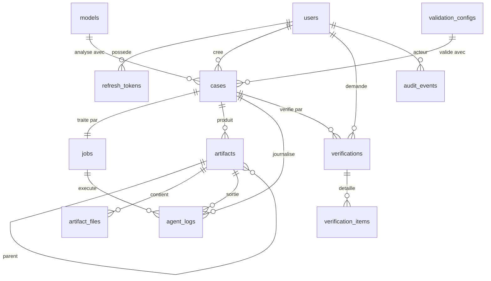

# SAAMSTIAHF — Backend Schema

| Owner | Reviewers | Status | Version | Last updated | Suite version | PRD | TRD | Architecture | System Design | App Flow |
|---|---|---|---|---|---|---|---|---|---|---|
| Équipe projet | Encadrant `[TBD: nom, Q-12]` | In review | 2.0.3 | 2026-11-09 | 2.1.3 | [01-prd.md](01-prd.md) | [02-trd.md](02-trd.md) | [03-architecture.md](03-architecture.md) | [05-system-design.md](05-system-design.md) | [06-app-flow.md](06-app-flow.md) |

DDL : [schema.sql](schema.sql) — **exécuté** le 2026-10-05 sur PostgreSQL 16.2 (0 erreur, 13 tables) + 8 tests de contraintes négatifs passés.

## 1. Moteur et périmètre

- **Base de données :** PostgreSQL 16 (conteneur `postgres`, Docker Compose, local) — ADR-06 (Architecture §11).
- **Registre :** Hyperledger Fabric 2.5, chaincode `provenance` (état LevelDB) — enregistrements `ARTIFACT` et `MODEL` (§5.2).
- **Stockage fichiers :** volume `/data/artifacts`, fichiers chiffrés AES-256-GCM (§14).
- **Périmètre :** toutes les données persistées du prototype v1. Les tables de checkpoint LangGraph (schéma `langgraph`) sont gérées par la bibliothèque et hors de ce document. Le volet matériel (F-18 à F-20) n'ajoute **aucune table ni aucun champ on-chain** : il ajoute deux fichiers à l'artefact `processed` (§5.3) et produit des rapports fichiers (§14).

## 2. Conventions

- **Nommage :** snake_case, tables au pluriel, FK `<entité>_id`, index `idx_<table>_<cols>`, unicité `uq_<table>_<cols>`.
- **Clés primaires :** UUID v4 (`gen_random_uuid()`), sauf journaux à fort volume (`bigint identity`). Les `artifacts.id` sont générés par l'agent **avant** l'ancrage, pour l'idempotence (TRD §22).
- **Colonnes standard :** `id`, `created_at` ; `updated_at` (trigger) sur les tables modifiables (users, cases, jobs).
- **Temps :** `timestamptz`, UTC.
- **Argent :** aucun.
- **Empreintes :** `char(64)` hexadécimal minuscule, vérifié par `CHECK`.
- **Texte :** UTF-8, longueur max par champ via `CHECK`.
- **Suppression :** pas de suppression logique ; purge physique admin (§16).

## 3. Diagramme ER

On-chain (Fabric) : `ARTIFACT` (1 par ligne `artifacts`, même id) ; `MODEL` (1 par ligne `models` active).

## 4. Entités

Propriétaire = seul module autorisé à écrire la table (Architecture §8, ADR-15). Les privilèges PostgreSQL de `schema.sql` restent par processus (`app_api`, `app_worker`).

| Entity | Represents | Kind | Owning component | PRD feature |
|---|---|---|---|---|
| E-users | Compte utilisateur et rôle | core | SVC-identity | F-13 |
| E-refresh_tokens | Session de rafraîchissement | auth | SVC-identity | F-13 |
| E-login_attempts | Tentative de connexion (verrouillage) | audit | SVC-identity | F-13 |
| E-cases | Un cas d'analyse pseudonymisé | core | SVC-cases | F-01, F-09, F-12 |
| E-jobs | Exécution du pipeline pour un cas | core | SVC-cases | F-09 |
| E-artifacts | Artefact du pipeline (7 types) | core | SVC-traceability | F-02–F-08, F-10, F-15, F-18–F-20 (source des vecteurs matériels) |
| E-artifact_files | Fichier chiffré d'un artefact | core | SVC-traceability | F-06, F-07 |
| E-agent_logs | Action d'un agent | audit | SVC-pipeline | F-09 |
| E-verifications | Exécution d'une vérification d'intégrité | core | SVC-verification | F-11 |
| E-verification_items | Statut d'un artefact dans une vérification | core | SVC-verification | F-11 |
| E-validation_configs | Seuils de validation versionnés | lookup | SVC-registry | F-04, F-15 |
| E-models | Version de modèle IA enregistrée | lookup | SVC-registry | F-03 |
| E-audit_events | Événement applicatif (PRD §11) | audit | SVC-audit | F-13, PRD §11 |
| E-ledger_artifact | Enregistrement `ARTIFACT` on-chain | ledger | SVC-chaincode | F-08, F-10, F-11 |
| E-ledger_model | Enregistrement `MODEL` on-chain | ledger | SVC-chaincode | F-03 (AC-04.3) |

## 5. Tables

### 5.1 PostgreSQL

Types, contraintes et index exacts : [schema.sql](schema.sql). Résumé des champs et des règles non évidentes :

#### users
Un compte. `email` (text, minuscules, unique, ≤ 254), `display_name` (1–100), `password_hash` (doit commencer par `$argon2id$`), `role` (`user_role`), `is_active`, `locked_until`, `last_login_at`, `created_by` → users (SET NULL).
- **Index :** `uq_users_email` (connexion).

#### refresh_tokens
Un jeton de rafraîchissement émis. `user_id` → users (CASCADE), `token_hash` (SHA-256 du jeton, unique — le jeton clair n'est jamais stocké), `expires_at` (> `created_at`), `revoked_at`, `user_agent`.
- **Index :** `idx_refresh_tokens_user` partiel (non révoqués).

#### login_attempts
Une tentative. `email` (minuscules), `ip` (inet), `succeeded`, `attempted_at`.
- **Index :** `(email, attempted_at DESC)` — compte des échecs sur 15 min (AC-11.3).

#### cases
Un cas. `case_ref` = `'CASE-' || id` (généré, unique — l'identifiant pseudonymisé du PRD), `created_by` → users (RESTRICT), `status` (`case_status`), `current_step` (`pipeline_step`), `ecg_format`, `original_sampling_hz` (50–10000), `has_report`, `model_id` → models (RESTRICT), `validation_config_id` → validation_configs (RESTRICT), champs dénormalisés `quality_score`, `predicted_class`, `confidence`, `decision`, `error_message`, `completed_at`.
- **Checks :** `decision` non nul ⇔ `status = termine` ; `completed_at` non nul ⇔ statut terminal.
- **Index :** `created_at DESC` (liste), `status`, `created_by`.

#### artifacts
Un artefact. `id` (fourni par l'agent), `case_id` → cases (CASCADE), `type`, `parent_artifact_id` → artifacts (RESTRICT), `sha256` (copie d'affichage — **la vérification lit l'empreinte sur Fabric**), `manifest_path`, `offchain_ref` = `artifact://<id>`, `created_by_agent`, `software_version` (git SHA ou semver), `model_version`, `anchor_status`, `anchor_attempts` (0–4 : 1 tentative + 3 réessais, AC-07.4), `tx_id`, `anchored_at`.
- **Unique :** `(case_id, type)` — un artefact de chaque type par cas.
- **Checks :** parent nul ⇔ type `original` ; `ancre` ⇔ `tx_id` et `anchored_at` présents ; créateur ≠ `verifier`/`orchestrator`.
- **Index :** `parent_artifact_id` ; `(case_id, type)` via la contrainte unique.

#### artifact_files
Un fichier chiffré. `artifact_id` → artifacts (CASCADE), `name` (`[A-Za-z0-9._-]{1,100}`), `media_type`, `size_bytes` (≤ 20 Mo), `sha256` (du clair), `storage_path` (unique).
- **Unique :** `(artifact_id, name)`.

#### jobs
L'exécution du pipeline d'un cas. `case_id` (unique) → cases (CASCADE), `status`, `attempts` ≤ `max_attempts` (défaut 3), `locked_by` (non nul ⇔ `en_cours`), `locked_at`, `heartbeat_at`, `last_error`.
- **Index :** partiel `en_file` par `created_at` (prise de job FIFO), partiel `en_cours` par `heartbeat_at` (détection de jobs bloqués > 5 min).

#### agent_logs
Une action d'agent (AC-08.3). `case_id` → cases (CASCADE), `job_id` → jobs (SET NULL), `agent`, `step`, `status`, `input_artifact_ids` (uuid[]), `output_artifact_id` → artifacts (SET NULL), `message` (≤ 1000), `details` (jsonb), `started_at`, `duration_ms`.
- **Index :** `(case_id, started_at)`.

#### verifications
Une vérification (AC-10.3). `case_id` → cases (CASCADE), `requested_by` → users (RESTRICT), `ledger_reachable`, compteurs par statut, `started_at`, `completed_at` (≥ `started_at`).
- **Index :** `(case_id, completed_at DESC)`.

#### verification_items
Le statut d'un artefact dans une vérification. `verification_id` → verifications (CASCADE), `artifact_id` (**sans FK** : peut désigner un artefact présent seulement on-chain), `artifact_type`, `status`, `expected_sha256` (lu sur Fabric), `computed_sha256` (recalculé), `detail`.
- **Checks :** `valide` ⇒ empreintes égales et non nulles ; `non_verifiable` ⇒ `expected_sha256` nul.
- **Unique :** `(verification_id, artifact_id)`.

#### validation_configs
Une version des seuils (Architecture §5.4). `version` (unique, > 0), `conf_high` (défaut seed 0,700), `quality_min` (défaut seed 0,900), `lexicon_version`, `is_active` (une seule active : index unique partiel), `created_by`. Lignes jamais modifiées : une modification = nouvelle version.

#### models
Une version de modèle. `name` + `version` (semver, unique ensemble), `framework`, `sha256` du fichier de poids, `file_path`, `metrics` (jsonb : `auc_macro`, `f1_macro`, fold), `is_active` (une seule ; exige `registered_tx_id`), `registered_tx_id`, `registered_at`.

#### audit_events
Événement applicatif. `event_type` (`[a-z_]{3,60}` : `login_succeeded`, `login_failed`, `case_created`, `pipeline_completed`, `artifact_anchored`, `anchoring_failed`, `integrity_check_completed`, `model_evaluated`, `user_created`, `user_updated`, `validation_config_created`, `model_activated`, `case_purged`), `actor_user_id` (SET NULL), `case_id` (SET NULL), `payload` (jsonb, **jamais de signal ni de texte de rapport**).

### 5.2 Enregistrements on-chain (chaincode `provenance`)

#### ARTIFACT — clé `artifactId` ; clé composite `case~artifact` = (`caseId`, `artifactId`)

| Field | Type | Required | Source | Constraint |
|---|---|---|---|---|
| docType | string | oui | chaincode | `"artifact"` |
| artifactId | string (uuid) | oui | client | unique ; refus si existe (AC-07.3) |
| caseId | string | oui | client | `^CASE-[0-9a-f-]{36}$` |
| artifactType | string | oui | client | enum `artifact_type` |
| sha256 | string | oui | client | `^[0-9a-f]{64}$` |
| createdAt | string | oui | client | ISO 8601 UTC |
| txTimestamp | string | oui | chaincode | horodatage de la proposition |
| softwareVersion | string | oui | client | ≤ 64 |
| modelVersion | string \| null | non | client | ≤ 64 |
| parentArtifactId | string \| null | oui | client | null ⇔ `original` ; sinon doit exister, même `caseId` |
| offchainRef | string | oui | client | `artifact://<artifactId>` |
| creatorMspId | string | oui | chaincode | depuis `ctx.clientIdentity` |
| creatorId | string | oui | chaincode | sujet X.509 (ex. `CN=agent-prediction`) |
| creatorAgent | string | oui | chaincode | attribut de certificat `agent` |

Tout champ supplémentaire → refus (NFR-03).

#### MODEL — clé composite `model` = (`name`, `version`)

| Field | Type | Required | Source | Constraint |
|---|---|---|---|---|
| docType | string | oui | chaincode | `"model"` |
| name, version | string | oui | client | comme `models` |
| sha256 | string | oui | client | `^[0-9a-f]{64}$` |
| framework | string | oui | client | ≤ 40 |
| registeredAt | string | oui | chaincode | horodatage de la proposition |
| registeredBy | string | oui | chaincode | sujet X.509 (attribut `role=model-admin`) |

### 5.3 Fichiers hors chaîne (par artefact)

Arborescence : `/data/artifacts/<case_id>/<artifact_id>/<name>.enc` ; `manifest.json.enc` toujours présent.

| Artifact type | Fichiers de charge utile | Métadonnées clés du manifeste |
|---|---|---|
| original | `ecg.hea`+`ecg.dat` ou `ecg.csv` (pseudonymisés), `report.txt` (si fourni) | format, fréquence d'origine, champs supprimés (noms, pas valeurs) |
| processed | `fir_input.npy` (int16 [12,5000], 500 Hz quantifié), `fir_stage.npy` (int16 [12,1011], sortie brute de l'étage FIR bit-exact), `signal.npy` (float32 [12,1000]), `processing_report.json` | filtres et paramètres, `fir_coef_id`, gain de quantification (1000/mV), rééchantillonnage éventuel, `quality_score`, qualité par dérivation |
| features | `input_tensor.npy`, `measures.json` | FC, RR moyen/écart-type, amplitudes |
| prediction | `prediction.json` | probabilités 5 classes, classe principale, modèle (nom, version, sha256), id entrée |
| validation | `validation.json` | version de config, résultat R1–R5 avec valeurs, décision |
| explanation | `explanation.json` (+ `saliency.npy` en P1) | texte FR, règles déterminantes, top-3 classes |
| final_result | `final_result.json` | décision, mention prototype, révision requise |

## 6. Enums et transitions

| Enum | Values | Allowed transitions |
|---|---|---|
| case_status | en_attente, en_cours, termine, erreur_ancrage, erreur | en_attente→en_cours ; en_cours→termine \| erreur_ancrage \| erreur ; en_cours→en_attente (job remis en file) ; terminaux ensuite |
| decision | accepte, revision_requise, rejete | fixée une fois à la finalisation, immuable |
| job_status | en_file, en_cours, termine, echec | en_file→en_cours ; en_cours→termine \| echec \| en_file (réessai si attempts < max) |
| anchor_status | en_attente, ancre, echec | en_attente→ancre \| echec ; echec→ancre (réessai manuel `scripts/reanchor.py`) |
| pipeline_step | ingestion … finalization (7) | ordre du graphe Architecture §5.2 ; saut vers finalization en cas de rejet |
| artifact_type | original, processed, features, prediction, validation, explanation, final_result | — |
| integrity_status | valide, modifie, manquant, non_verifiable | — (calculé à chaque vérification) |
| user_role | operator, auditor, admin | modifiable par un admin uniquement |
| agent_name | orchestrator, ingestion, preparation, features, prediction, validation, explanation, finalization, verifier | — |
| log_status | succes, echec, ignore | — |
| predicted_class | NORM, MI, STTC, CD, HYP | — |

Correspondance PRD : « statut `en_cours` » (AC-01.1) = `case_status.en_cours` ; « le cas passe au statut rejeté » (AC-03.3, AC-04.3) = `status = termine` + `decision = rejete` (un résultat final « Rejeté » est produit et ancré, AC-08.2) ; « `erreur_ancrage` » (AC-07.4) = `case_status.erreur_ancrage`.

## 7. Relations

| From | To | Type | Foreign key | On delete | Join table |
|---|---|---|---|---|---|
| refresh_tokens | users | N:1 | user_id | CASCADE | — |
| users | users | N:1 | created_by | SET NULL | — |
| cases | users | N:1 | created_by | RESTRICT | — |
| cases | models | N:1 | model_id | RESTRICT | — |
| cases | validation_configs | N:1 | validation_config_id | RESTRICT | — |
| jobs | cases | 1:1 | case_id (unique) | CASCADE | — |
| artifacts | cases | N:1 | case_id | CASCADE | — |
| artifacts | artifacts | N:1 | parent_artifact_id | RESTRICT (cascade de cas supprime tout l'arbre) | — |
| artifact_files | artifacts | N:1 | artifact_id | CASCADE | — |
| agent_logs | cases | N:1 | case_id | CASCADE | — |
| agent_logs | jobs | N:1 | job_id | SET NULL | — |
| agent_logs | artifacts | N:1 | output_artifact_id | SET NULL | — |
| verifications | cases | N:1 | case_id | CASCADE | — |
| verifications | users | N:1 | requested_by | RESTRICT | — |
| verification_items | verifications | N:1 | verification_id | CASCADE | — |
| validation_configs, audit_events | users | N:1 | created_by / actor_user_id | SET NULL | — |
| audit_events | cases | N:1 | case_id | SET NULL | — |

Seul un admin peut supprimer un cas (purge) ; aucune cascade n'est déclenchable par un operator ou un auditor.

## 8. Propriété et multi-tenance

- **Mono-locataire :** une seule organisation (prototype). Pas de colonne de tenant.
- **Propriété :** `cases.created_by` trace l'opérateur ; tous les rôles lisent tous les cas (besoin d'audit, PRD §3).
- **Départ d'un utilisateur :** désactivation (`is_active = false`), jamais de suppression d'un utilisateur ayant créé des cas (RESTRICT).

## 9. Authentification

- **Tables :** users, refresh_tokens, login_attempts. Pas de vérification e-mail, OAuth ni réinitialisation par e-mail (TRD §9).
- **Flux :** l'admin crée le compte → connexion → rafraîchissement → déconnexion (révocation du refresh token). Réinitialisation du mot de passe par l'admin.
- **Hachage :** Argon2id (argon2-cffi, paramètres par défaut de la bibliothèque `[TBD: fixer m/t/p dans la config]`).
- **Expiration :** accès 30 min, rafraîchissement 8 h.
- **Limites :** 5 échecs / 15 min par e-mail → `locked_until = now() + 15 min` ; 10 req/min/IP sur `/auth/login`.

## 10. Règles d'autorisation

- **Appliquées dans :** couche API (dépendance FastAPI par route) **et** privilèges PostgreSQL par service (`app_api`, `app_worker`, voir fin de `schema.sql`). Chaincode : attributs de certificat (TRD §9).

| Entity | Role | Create | Read | Update | Delete | Conditions |
|---|---|---|---|---|---|---|
| users | admin | oui | oui | oui | non (désactiver) | ne peut pas se retirer son propre rôle admin |
| users | operator, auditor | non | soi-même (`/me`) | non | non | — |
| refresh_tokens | tout utilisateur | à la connexion | non | révocation (les siens) | expiration | — |
| login_attempts | système | oui | admin | non | non | — |
| cases | operator, admin | oui | oui | non (worker seul) | admin (purge) | — |
| cases | auditor | **non** (AC-11.2) | oui | non | non | — |
| jobs | api (service) | à la création du cas | admin | worker | cascade | — |
| artifacts, artifact_files | worker | oui | tous les rôles (via API, déchiffrés pour l'affichage) | worker : statut d'ancrage seulement | cascade | contenu jamais modifiable par l'API |
| agent_logs | worker | oui | tous les rôles | non | cascade | — |
| verifications, verification_items | tous les rôles | oui | tous les rôles | non | cascade | — |
| validation_configs | admin (via `scripts/registry.py`, D-17) | oui (nouvelle version) | admin (script) ; versions utilisées visibles dans chaque artefact `validation` | `is_active` seulement | non | — |
| models | `scripts/register_model.py` | oui | admin (script) ; modèle actif visible sur S-12 | admin via `scripts/registry.py` : `is_active` | non | activation exige l'ancrage `MODEL` |
| audit_events | api, worker | oui | admin | non | non | — |
| ARTIFACT (on-chain) | identité `role=pipeline-agent` | oui | toutes identités du canal | **jamais** | **jamais** | — |
| MODEL (on-chain) | identité `role=model-admin` | oui | toutes identités | jamais | jamais | — |

- **Règles par champ :** un utilisateur ne peut changer ni son rôle ni `is_active` ; `artifacts.sha256`, `type`, `parent_artifact_id` ne sont jamais mis à jour après insertion (seuls `anchor_*`, `tx_id`, `anchored_at`).

## 11. Validation des données

| Entity.field | Rule | Enforced in |
|---|---|---|
| users.email | format, minuscules, unique | DB + API |
| users.password (clair) | ≥ 12 caractères | API |
| upload ECG | WFDB (`.hea`+`.dat`) ou CSV 12 colonnes (I, II, III, aVR, aVL, aVF, V1–V6) ; ≤ 20 Mo au total ; durée ≥ 10 s | API (AC-01.2) + agent ingestion |
| upload CSV | `csv_sampling_rate` requis, 50–10000 Hz | API + DB (`original_sampling_hz`) |
| rapport | texte UTF-8 ≤ 10 000 caractères (`report_file` .txt ou `report_text`) | API |
| *.sha256 | `^[0-9a-f]{64}$` | DB + chaincode |
| artifacts | parent obligatoire sauf `original` | DB + chaincode |
| validation_configs.conf_high, quality_min | ]0, 1] | DB + API |
| cases.confidence, quality_score | [0, 1] | DB |

- **Règles métier :** un seul artefact par type et par cas ; le parent d'un artefact appartient au même cas (chaincode ; côté DB garanti par le worker `[TBD: trigger si temps]`) ; une décision n'est posée qu'au statut `termine` ; une seule config et un seul modèle actifs.

## 12. Concurrence et cohérence

- Prise de job : `SELECT … FROM jobs WHERE status='en_file' ORDER BY created_at FOR UPDATE SKIP LOCKED LIMIT 1`.
- Création de cas : `cases` + `jobs` + `audit_events` dans une transaction.
- Ancrage idempotent : `artifacts.id` persisté avant l'appel Fabric ; réponse « existe déjà avec la même empreinte » = succès ; empreinte différente = erreur bloquante.
- Écriture d'un artefact : fichiers chiffrés écrits → ligne `artifacts` (`en_attente`) → ancrage → mise à jour `ancre`. Un crash entre deux étapes est rejoué depuis le checkpoint LangGraph.

## 13. Données dérivées et dénormalisées

| Field | Derived from | Kept in sync by |
|---|---|---|
| cases.case_ref | cases.id | colonne générée |
| cases.quality_score | artefact `processed` | agent preparation |
| cases.predicted_class, confidence | artefact `prediction` | agent prediction |
| cases.decision | artefact `final_result` | agent finalization |
| cases.current_step, status | progression du graphe | orchestrateur |
| artifacts.sha256 | manifeste (copie) | worker ; jamais utilisé pour vérifier |
| verifications.count_* | verification_items | api, même transaction |

## 14. Fichiers et médias

- **Emplacement :** volume Docker `/data/artifacts` (§5.3), monté en lecture/écriture dans `worker`, lecture seule dans `api`.
- **En base :** `artifact_files` (nom, type MIME, taille, sha256 du clair, chemin) + `artifacts.manifest_path`.
- **Chiffrement :** AES-256-GCM par fichier, nonce 96 bits aléatoire préfixé au fichier, AAD = `artifact_id|name`, clé `ARTIFACT_KEY`.
- **Limites :** 20 Mo par téléversement ; extensions `.hea`, `.dat`, `.csv`, `.txt` ; noms de fichiers régénérés côté serveur.
- **Accès :** uniquement via l'API (aucun accès direct au volume depuis le navigateur).
- **Volet matériel :** `scripts/export_hw_vectors.py --case` (admin, `ARTIFACT_KEY` requise) déchiffre les 7 manifestes et `fir_input.npy` / `fir_stage.npy` d'un cas vers `hw/vectors/cases/<case_ref>/` (ignoré par git, supprimé après usage). Les rapports de co-vérification (`hw/reports/*.md|json`) ne contiennent que des empreintes, des identifiants d'artefacts et des verdicts — aucun échantillon de signal — et sont versionnés dans le dépôt, pas en base.

## 15. Données sensibles et audit

| Field | Classification | Protection |
|---|---|---|
| Fichiers `original` (signal, rapport) | données de santé pseudonymisées | chiffrés au repos ; jamais en base ni on-chain ; jamais journalisés |
| Fichiers dérivés (processed, features, …) | données de santé pseudonymisées | chiffrés au repos |
| cases.predicted_class, confidence, decision | donnée de santé dérivée | base accessible aux seuls services ; pas dans les logs applicatifs |
| users.password_hash | secret | Argon2id |
| refresh_tokens.token_hash | secret | SHA-256 du jeton ; clair jamais stocké |
| users.email, login_attempts.ip | personnel | masqués dans les logs (`o***@demo.test`) |
| ARTIFACT / MODEL on-chain | métadonnées techniques | schéma fermé, aucune donnée de santé (NFR-03) |
| `hw/vectors/cases/*` (exports matériels) | données de santé pseudonymisées (déchiffrées) | export admin seulement, hors git, supprimées après co-vérification |

- **Journal d'audit :** `audit_events` (actions utilisateurs et événements PRD §11) + `agent_logs` + le registre Fabric. Conservés pendant toute la durée du projet.

## 16. Rétention, suppression, droits

| Entity | Delete type | Retention period | Legal basis | Purge |
|---|---|---|---|---|
| cases (+ jobs, artifacts, files, logs, vérifications) | physique (cascade) + suppression des fichiers | durée du projet ; purge après la soutenance `[TBD: Q-09]` | données publiques PTB-XL, usage pédagogique | manuelle, admin (`scripts/purge_case.py`) |
| ARTIFACT / MODEL on-chain | impossible (immuable) | durée de vie du réseau de test | empreintes seulement | destruction du réseau |
| users | désactivation | durée du projet | — | manuelle |
| refresh_tokens | physique | 8 h + 7 jours | — | tâche au démarrage de l'API |
| login_attempts | physique | 30 jours | — | tâche au démarrage de l'API |
| audit_events | — | durée du projet | — | aucune |

- **Effacement / export :** sans objet pour des données publiques ; le mécanisme (purge hors chaîne, empreintes seules on-chain) est celui qu'on utiliserait pour un droit à l'effacement : l'empreinte restante ne permet pas de reconstituer la donnée.

## 17. Requêtes clés et performance

| Query | Frequency | Supporting index |
|---|---|---|
| Prendre le prochain job | 1/s (worker) | `idx_jobs_queue` (partiel) |
| Détecter les jobs bloqués | 1/min | `idx_jobs_running_heartbeat` |
| Détail d'un cas + ses artefacts | polling 2 s pendant le traitement | PK cases ; `artifacts (case_id, type)` unique |
| Liste des cas (récents d'abord, filtre statut) | à l'ouverture du tableau de bord | `idx_cases_created_at`, `idx_cases_status` |
| Journal des agents d'un cas | à la demande | `idx_agent_logs_case_time` |
| Dernières vérifications d'un cas | à la demande | `idx_verifications_case_time` |
| Échecs de connexion récents | à chaque login | `idx_login_attempts_email_time` |
| Utilisateur par e-mail | à chaque login | `uq_users_email` |
| Historique on-chain d'un cas | à la demande | clé composite `case~artifact` (Fabric) |

- **Volume attendu :** < 100 cas, < 700 artefacts, < 2 000 lignes de logs pour le projet.
- **Pagination :** offset (`page`, `size` ≤ 50) sur la liste des cas ; les autres listes sont bornées par cas.

## 18. Migrations et seed

- **Outil :** Alembic ; la migration initiale reproduit `schema.sql` (test CI : `alembic upgrade head` puis diff `pg_dump --schema-only`).
- **Processus :** une PR par migration, relue par un second membre.
- **Rollback :** `alembic downgrade -1` ; en démo, restauration de sauvegarde.
- **Seed (dev et démo) :** 1 admin, 1 operator, 1 auditor (identifiants dans `.env.example` / `seed.py`, jamais en clair dans la doc) ; `validation_configs` v1 (0,700 / 0,900 / lexique v1, active) ; modèle `ecg-cnn1d` 1.0.0 enregistré on-chain et actif.

## 19. Sauvegardes et environnements

- **Sauvegardes :** `pg_dump` + archive du volume artefacts + volumes Fabric avant chaque répétition et la veille de la démo ; restauration testée en M5 (T5.7, ≤ 2026-11-25 ; TRD §14, System Design §12).
- **Données en environnement inférieur :** uniquement PTB-XL public.

## 20. Hypothèses

- Un seul artefact de chaque type par cas suffit (pas de ré-exécution partielle produisant une seconde version).
- Les 7 artefacts d'un cas tiennent sous 20 Mo au total (l'ajout de `fir_input.npy` ≈ 120 ko et `fir_stage.npy` ≈ 24 ko ne change rien).
- Les vérifications et leur détail ne contiennent aucune donnée de santé (seulement empreintes et statuts).

## 21. Questions ouvertes

Voir [review.md](review.md).
