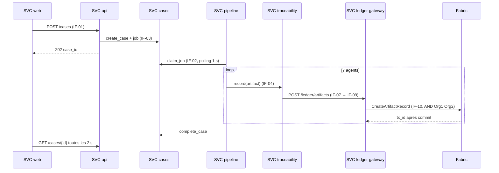

# SAAMSTIAHF — System Design

| Owner | Reviewers | Status | Version | Last updated | Suite version | TRD | Architecture | Schema | App Flow |
|---|---|---|---|---|---|---|---|---|---|
| Équipe projet (B) | Encadrant `[TBD: nom, Q-12]` | In review | 1.0.2 | 2026-11-09 | 2.1.3 | [02-trd.md](02-trd.md) | [03-architecture.md](03-architecture.md) | [04-backend-schema.md](04-backend-schema.md) | [06-app-flow.md](06-app-flow.md) |

## 1. Objet et périmètre

Montre que les cibles NFR du TRD sont atteignables avec l'architecture retenue, sur la machine de démo : modèle de charge, capacité, flux critiques avec budgets de latence, cohérence, traitements asynchrones, montée en charge et modes de défaillance (FM-ID). Les cibles elles-mêmes sont dans le TRD §14 ; les composants (SVC-ID) et interfaces (IF-ID) dans l'Architecture.

Toutes les durées ci-dessous sont des **estimations** à valider par mesure ; chaque hypothèse de latence non mesurée est marquée `[TBD: mesure Tx.y]`.

## 2. Cibles

| NFR | Cible (TRD §14) | Preuve |
|---|---|---|
| NFR-01 | Pipeline p95 ≤ 60 s, 1 cas à la fois | DF-01 (≈ 27 s estimé) ; banc T5.4 |
| NFR-02 | Vérification d'un cas p95 ≤ 10 s | DF-02 (≈ 1,9 s estimé) ; banc T5.4 |
| NFR-15 | `GET /cases/{id}` p95 ≤ 300 ms à 5 utilisateurs | DF-03 (≈ 45 ms estimé) ; banc T5.4 |
| NFR-11 | `/health` vert pendant la démo | §13 ; FM-04, FM-06, FM-07 ; répétitions T6.3 |
| NFR-17 | WNS ≥ 0 à 100 MHz | Rapport de timing Vivado T3.21, T5.8 |
| NFR-18 | ≤ 50 % des ressources du XC7Z010 | Rapport d'utilisation T3.21 |
| NFR-20 | Étape 9 ≤ 15 s à 115 200 bauds | DF-05 (≈ 1,9 s estimé) ; T4.13 |
| NFR-08 | Toute modification détectée | DF-02 ; FM-08 ; `tests/integrity` T5.1 |
| NFR-16 | 100 % des vecteurs identiques | DF-06 ; co-vérification N1 (T3.18–T3.20) et N2 (T4.14) |
| NFR-03, NFR-04, NFR-05 | Confidentialité, chiffrement, accès | Hors charge : preuve par tests T2.9, T3.2, T2.4 (TRD §14) |
| NFR-06, NFR-07, NFR-12, NFR-14 | Traçabilité, reproductibilité | Hors charge : §7 (ordre d'écriture) ; tests T3.1, T3.5, T3.17 |
| NFR-09, NFR-10, NFR-13, NFR-19, NFR-21 | Accessibilité, langue, modularité, build, précision FIR | Hors charge : tests T5.3, T1.11, T5.8, T2.10 |

## 3. Modèle de charge

| Input | Démo / projet | 12 mois | Source |
|---|---|---|---|
| Utilisateurs simultanés | ≤ 5 | Sans objet (prototype) | TRD §14 |
| Cas créés | < 100 sur le projet ; 5 à 10 le jour de la soutenance | Sans objet | TRD §14 |
| Cas traités en parallèle | 1 (`WORKER_CONCURRENCY=1`) | Sans objet | TRD §11 |
| Lectures pendant un traitement | 1 requête / 2 s par écran S-04 ouvert | Sans objet | ADR-11 |
| Vérifications | ≤ 1 par minute | Sans objet | Hypothèse (démo) |
| Taille d'un téléversement | ≈ 131 ko typique (PTB-XL `records500`) ; 20 Mo max | Sans objet | Schema §11 |
| Rapport lecture : écriture | ≈ 30 : 1 pendant un traitement (polling) | Sans objet | Calcul §4 |

## 4. Capacité

**Requêtes par seconde**
- Polling : 5 écrans × 1 req / 2 s = **2,5 req/s** au maximum.
- Création de cas : limitée à 10 / min / utilisateur (TRD §8) → au plus 50 / min, mais traités un par un (§8).
- Transactions Fabric : 7 par cas ; débit max ≈ 7 / 27 s ≈ **0,26 tx/s** (DF-01).

**Stockage par cas** (fichiers clairs ; surcoût GCM 28 o/fichier négligeable)

| Artefact | Formule | Taille |
|---|---|---|
| original | 500 Hz × 10 s × 12 dérivations × 2 o + en-tête 1 ko + rapport ≤ 10 ko | ≈ 131 ko |
| processed | `fir_input` 12×5 000×2 o + `fir_stage` 12×1 011×2 o + `signal` 12×1 000×4 o + rapport 3 ko | ≈ 196 ko |
| features | 12×1 000×4 o + mesures 2 ko | ≈ 50 ko |
| prediction, validation, explanation, final_result | 4 × ≈ 2 ko | ≈ 8 ko |
| manifestes | 7 × ≈ 1 ko | ≈ 7 ko |
| **Total** | | **≈ 392 ko / cas → ≈ 39 Mo pour 100 cas** |

- PostgreSQL : ≈ 40 lignes / cas × ≈ 0,5 ko → ≈ 2 Mo pour 100 cas.
- Fabric : 7 enregistrements × ≈ 0,7 ko → ≈ 0,5 Mo d'état pour 100 cas, 700 transactions.
- Entraînement : cache préparé 21 799 × 12 × 1 000 × 4 o ≈ **1,05 Go** (float32) ; archive `records500` `[TBD: taille mesurée en T1.6]` ; poids du modèle ≈ 0,5 M × 4 o ≈ 2 Mo.

**Bande passante** : négligeable en local (≤ 20 Mo par téléversement, ≈ 5 ko par réponse de polling).

**Connexions** : pool `api` 5 + `worker` 2 + checkpointer LangGraph 2 ≈ **9 connexions PostgreSQL** (≪ `max_connections` 100 par défaut).

**UART** : 115 200 bauds / 10 bits = **11 520 o/s** ; 921 600 bauds → 92 160 o/s.

**Marge visée** : chaque flux critique ≤ 60 % de sa cible NFR.

## 5. Flux de données

### DF-01 : créer et traiter un cas (J-01 ; US-01 à US-08 ; NFR-01)

| Step | Component / interface | Sync/async | Latency budget | Notes |
|---|---|---|---|---|
| 1 | SVC-web → SVC-api (IF-01) : téléversement + validation | sync | 1,0 s | 131 ko en local |
| 2 | SVC-api → SVC-cases (IF-03) : cas + job en une transaction | sync | 0,05 s | |
| 3 | SVC-pipeline prend le job (IF-02) | async | ≤ 1,0 s | polling 1 s |
| 4 | `ingestion` : calcul 0,5 s + `record` (chiffrer, hacher, écrire 0,1 s ; ancrer 2,5 s) | sync | 3,1 s | ancrage `[TBD: mesure T1.8]` |
| 5 | `preparation` : calcul 1,0 s + `record` 2,6 s | sync | 3,6 s | FIR bit-exact en NumPy entier |
| 6 | `features` : 0,5 s + 2,6 s | sync | 3,1 s | |
| 7 | `prediction` : `GetModel` 0,2 s + inférence CPU 1,0 s + 2,6 s | sync | 3,8 s | ADR-08 |
| 8 | `validation` : R5 sur 4 ancêtres (4 × 0,25 s) + règles 0,1 s + 2,6 s | sync | 3,7 s | IF-08 sans persistance |
| 9 | `explanation` : 0,2 s + 2,6 s | sync | 2,8 s | |
| 10 | `finalization` : 0,1 s + 2,6 s | sync | 2,7 s | |
| 11 | SVC-web voit l'état terminal | async | ≤ 2,0 s | polling 2 s |
| **Total** | | | **≈ 26,9 s ≤ 60 s (45 % de la cible)** | |

Sensibilité : hors ancrage, le flux coûte ≈ 8,6 s ; NFR-01 tient tant que la latence d'un ancrage reste **≤ 7,3 s** ((60 − 8,6) / 7). Au-delà : `BatchTimeout` de l'orderer à 0,5 s (§10).

### DF-02 : vérifier un cas (J-02 ; US-10 ; NFR-02)

| Step | Component / interface | Sync/async | Latency budget | Notes |
|---|---|---|---|---|
| 1 | SVC-web → SVC-api (IF-01) | sync | 0,05 s | |
| 2 | SVC-verification : 7 × (`GetArtifactRecord` 0,2 s + lecture, déchiffrement, hachage 0,05 s) | sync | 1,75 s | evaluate, sans commit `[TBD: mesure T1.8]` |
| 3 | Persistance `E-verifications` + items | sync | 0,05 s | une transaction |
| 4 | Réponse | sync | 0,05 s | |
| **Total** | | | **≈ 1,9 s ≤ 10 s (19 %)** | |

### DF-03 : lire un cas (S-04 ; US-04 à US-07 ; NFR-15)

| Step | Component / interface | Sync/async | Latency budget | Notes |
|---|---|---|---|---|
| 1 | nginx → SVC-api, contrôle JWT (IF-11) | sync | 5 ms | |
| 2 | SVC-cases + SVC-traceability : cas + 7 lignes d'artefacts | sync | 10 ms | index PK + `(case_id, type)` |
| 3 | Déchiffrement et lecture de 4 petits JSON (IF-04) | sync | 20 ms | sans re-vérification on-chain |
| 4 | Sérialisation + réseau local | sync | 10 ms | |
| **Total** | | | **≈ 45 ms ≤ 300 ms (15 %)** | |

### DF-04 : historique d'un cas (S-05 ; US-09)

SVC-api → SVC-ledger-client (IF-07) → `GetCaseHistory` (IF-10, evaluate) ≈ 0,3 s `[TBD: mesure T4.2]`. Pas de NFR ; délai d'attente côté interface 10 s (App Flow §10, S-05).

### DF-05 : étape matérielle de la démo (J-11 ; US-17 ; NFR-20)

| Step | Component / interface | Sync/async | Latency budget | Notes |
|---|---|---|---|---|
| 1 | SVC-hw-host lit les vecteurs exportés + empreinte on-chain (IF-07) | sync | 0,2 s | export fait avant la démo |
| 2 | `INFO` (IF-14) | sync | 0,01 s | |
| 3 | `SHA256` d'un manifeste ≈ 1 ko | sync | 0,1 s | 1 000 o / 11 520 o/s |
| 4 | `FIR` d'une dérivation : 10 110 o envoyés + 2 022 o reçus | sync | 1,1 s | calcul PL < 10 ms |
| 5 | Comparaison + affichage | sync | 0,5 s | |
| **Total** | | | **≈ 1,9 s ≤ 15 s (13 %)** | |

### DF-06 : co-vérification complète sur carte (J-10 ; US-15 à US-17)

7 manifestes (≈ 7 ko) + 12 dérivations × (10 110 + 2 022) o ≈ 153 ko → **≈ 13,3 s à 115 200 bauds**, ≈ 1,7 s à 921 600 bauds. Pas de NFR.

### DF-07 : connexion (S-01 ; US-11)

Vérification Argon2id + lecture des tentatives (index `(email, attempted_at)`) ≈ 0,1 s `[TBD: paramètres Argon2id, Schema §9]`. Pas de NFR.

## 6. Cache

| What | Where | Key | TTL | Invalidation | Staleness allowed | Hit-rate target |
|---|---|---|---|---|---|---|
| Poids du modèle actif | Mémoire du processus `worker` | `models.sha256` | Durée du processus | Rechargé si `active_model()` renvoie une autre empreinte au début d'un job | Aucune (empreinte vérifiée par job) | ≈ 100 % |
| Données d'un cas (SVC-web) | Cache TanStack Query | `['case', case_ref]` | `staleTime` 0 pendant le traitement | Chaque polling | ≤ 2 s | Sans objet |

Aucun autre cache : les lectures sont déjà sous 50 ms (DF-03), et une empreinte ne doit jamais être lue ailleurs que sur la chaîne pour une vérification (moteur 1).

## 7. Stockage et cohérence

- **Cohérence par entité :** forte pour toutes les tables PostgreSQL (une seule instance, transactions) ; forte pour les enregistrements Fabric après commit (Raft, pas de fourche) ; les copies `artifacts.sha256` et `tx_id` en base sont des copies d'affichage, jamais utilisées pour vérifier.
- **Ordre d'écriture d'un artefact (SVC-traceability) :** (1) `artifact_id` généré et enregistré dans l'état LangGraph ; (2) fichiers chiffrés écrits sous ce même id ; (3) ligne `artifacts` en `en_attente` ; (4) ancrage avec réessais ; (5) ligne passée à `ancre`. Une reprise après panne réutilise l'id (état LangGraph), réécrit les mêmes fichiers et traite un doublon de même empreinte comme un succès (FM-13).
- **Partitionnement :** aucun (un seul nœud).
- **Réplication :** aucune ; sauvegardes manuelles (§12).
- **Transactions entre composants :** pas de transaction distribuée ; la ligne `en_attente` sert d'intention. En cas d'échec d'ancrage, fichiers et ligne restent, le cas passe en `erreur_ancrage` et `scripts/reanchor.py` termine l'ancrage plus tard (idempotent par `artifact_id`).

## 8. Traitements asynchrones

| Queue / topic | Producer | Consumer | Delivery | Ordering | Idempotency key | Retries and backoff | Dead letter |
|---|---|---|---|---|---|---|---|
| Table `jobs` (IF-02) | SVC-cases (appelé par SVC-api) | SVC-pipeline | Au moins une fois (heartbeat > 5 min → remise en file) | FIFO par `created_at` (un seul consommateur) | `case_id` (un job par cas) ; `artifact_id` par artefact | `attempts` ≤ 3 ; reprise au dernier checkpoint | `jobs.status = echec` + `last_error` ; cas `erreur` ; relance manuelle par l'admin (`scripts/requeue.py`) |
| Ancrage d'un artefact (dans un job) | SVC-traceability | SVC-ledger-gateway | Au moins une fois | Ordre des agents | `artifact_id` (refus de doublon par le chaincode) | 1 tentative + 3 réessais (1 s, 2 s, 4 s) | Cas `erreur_ancrage` ; `scripts/reanchor.py` |
| Événement `ArtifactAnchored` | SVC-chaincode | SVC-ledger-gateway | Au plus une fois | Sans objet | Sans objet (journalisation seule) | Aucun | Aucun |

## 9. Limitation de débit et contre-pression

- `/auth/login` : 10 req/min/IP ; `POST /cases` : 10 req/min/utilisateur ; téléversement ≤ 20 Mo (TRD §8).
- Contre-pression : un seul job à la fois ; les cas suivants restent `en_attente` (≈ 27 s chacun). Avec 10 cas en file, le dernier termine après ≈ 4,5 min (il démarre après ≈ 4 min) ; l'interface l'affiche (S-04 « en attente »).
- Pas de délestage nécessaire à ≤ 5 utilisateurs.

## 10. Montée en charge

| Component | Scales by | Bottleneck at | Next step |
|---|---|---|---|
| SVC-pipeline (`worker`) | `WORKER_CONCURRENCY` ou plusieurs conteneurs | ≈ 2,2 cas/min (60 / 27 s), dominé par 7 ancrages séquentiels | Concurrence 3 ; l'ordre reste garanti à l'intérieur d'un cas |
| Fabric (orderer) | `BatchTimeout`, taille de bloc | Latence d'ancrage ≈ 2,5 s `[TBD: mesure T1.8]` | `BatchTimeout` 0,5 s |
| SVC-api | Workers uvicorn | Aucun à 5 utilisateurs (2,5 req/s) | 2 workers |
| PostgreSQL | Taille d'instance | Lointain (< 10 connexions, < 50 Mo) | Sans objet |
| Carte Zybo (UART) | Débit série | 11,5 ko/s → 13,3 s pour DF-06 | 921 600 bauds (T1.9) |

- **Premier goulot à 10× (10 cas soumis ensemble) :** la file unique + l'ancrage séquentiel ; le dixième cas termine après ≈ 4,5 min. NFR-01 reste tenue par cas (sa condition est « 1 cas à la fois »). Étape suivante : concurrence 3 + `BatchTimeout` 0,5 s.

## 11. Modes de défaillance

| ID | Component or dependency | Failure | Detection | Blast radius | Mitigation | Recovery | User sees (screen) |
|---|---|---|---|---|---|---|---|
| FM-01 | SVC-chaincode / réseau Fabric (peer ou orderer) | Ancrage impossible ou > 10 s pendant un job | `LedgerUnavailable` (IF-07) | Cas en cours | Délai 10 s ; 1 + 3 réessais (1, 2, 4 s) | `erreur_ancrage` ; `reanchor.py` après redémarrage | S-04 : « Ancrage sur la blockchain impossible — résultat non émis. » |
| FM-02 | Réseau Fabric | Injoignable pendant une vérification | Erreur d'évaluation | Cette vérification | Pas de réessai ; statuts `non_vérifiable` enregistrés | Relancer la vérification | S-06 : bandeau + statuts « Non vérifiable » |
| FM-03 | Réseau Fabric | Injoignable pendant la lecture de l'historique | 502 / délai 10 s | S-05 | Bouton Réessayer | Manuel | S-05 : « Registre blockchain injoignable — historique indisponible. Réessayer. » |
| FM-04 | SVC-ledger-gateway | Conteneur arrêté | Connexion refusée ; `/health` rouge | Tous les ancrages et lectures on-chain | Politique de redémarrage Docker ; mêmes réponses que FM-01 à FM-03 | Automatique | Bandeau global « Service partiellement indisponible : ledger-gateway » (App Flow §18) + messages FM-01 à FM-03 |
| FM-05 | SVC-pipeline (`worker`) | Plantage en cours de job | Heartbeat > 5 min | Cas en cours retardé | Remise en file, reprise au checkpoint, ancrage idempotent | Automatique (≤ 5 min + redémarrage) | S-04 reste « en cours » ; après 120 s : « Le traitement prend plus de temps que prévu. » |
| FM-06 | PostgreSQL | Base arrêtée | Erreurs de connexion ; `/health` rouge | Toute l'application | Aucune redondance | Redémarrage ; restauration si corruption (RTO ≤ 30 min) | S-04 : « Connexion perdue, nouvelle tentative… » ; ailleurs « Service indisponible. Réessayer. » ; bandeau global (App Flow §18) |
| FM-07 | SVC-api | Processus arrêté | nginx 502 ; `/health` injoignable | Toute l'interface | Politique de redémarrage | Automatique | S-01 : « Service indisponible. Réessayer. » ; S-04 : « Connexion perdue, nouvelle tentative… » |
| FM-08 | Stockage des artefacts | Fichier absent ou altéré | Vérification ; règle R5 | Un cas | Aucune (c'est la détection voulue) | Restauration depuis sauvegarde | S-06 : « Manquant » / « Modifié » ; pendant un job : décision « Rejeté » (S-04) |
| FM-09 | Stockage des artefacts | Disque plein | Erreur d'écriture | Nouveaux cas | Aucune | Libérer de l'espace, relancer (`requeue.py`) | S-04 : « Le traitement a échoué : {error_message} » |
| FM-10 | SVC-registry (poids du modèle) | Poids absents ou modifiés | Empreinte ≠ `MODEL` on-chain | Tous les nouveaux cas | Refus d'inférer (AC-04.3) | Restaurer les poids de la release | S-04 : décision « Rejeté » avec la raison « modèle non vérifiable » |
| FM-11 | SVC-api (entrée) | Téléversement invalide ou malveillant | Validation 400 | Cette requête | Taille, extension, parsing sans exécution | Sans objet | S-03 : messages par champ (App Flow §10) |
| FM-12 | SVC-identity | Attaque par force brute | 5 échecs / 15 min ; 10 req/min/IP | Un compte | Verrouillage 15 min ; 429 | Automatique | S-01 : « Trop de tentatives. Réessayez dans 15 minutes. » / « Trop de requêtes, patientez une minute. » |
| FM-13 | SVC-traceability (reprise) | Double ancrage après rejeu | Code `DUPLICATE` (IF-10) | Aucun si même empreinte | Même empreinte = succès ; empreinte différente = erreur bloquante | Automatique / manuel | Rien si même empreinte ; sinon S-04 « Ancrage sur la blockchain impossible — résultat non émis. » |
| FM-14 | SVC-ps-app (carte) | Carte débranchée ou non démarrée | Pas de réponse à `INFO` en 3 s | CLI matériel seulement | Code de sortie 2, aucun verdict | Vérifier câble et SD ; vidéo de secours (T6.5) | CLI : « Carte injoignable — vérifiez le câble USB et le démarrage SD. » |
| FM-15 | Liaison UART | Erreurs de transmission | CRC invalide | Une commande | 3 réessais | Automatique | CLI : « Erreur de transmission » |
| FM-16 | SVC-hw-fir | Coefficients de la carte ≠ ceux du cas | `COEF_ID` ≠ `fir_coef_id` | Comparaison FIR seulement | FIR non comparé | Flasher le bon `BOOT.bin` | CLI : « Coefficients différents (carte : …, cas : …) » |
| FM-17 | SVC-hw-sha256 / SVC-hw-fir | Résultat matériel faux (défaut) | Verdict « DIFFÉRENT » | Co-vérification | Aucun résultat matériel n'est utilisé ailleurs (ADR-16) | Corriger le VHDL ; régression N1 | CLI : « DIFFÉRENT — la valeur calculée par la carte ne correspond pas à la référence. » |
| FM-18 | SVC-web (nginx) | Conteneur arrêté | Page inaccessible | Toute l'interface | Politique de redémarrage | Automatique | Page d'erreur du navigateur (hors application) |
| FM-19 | PhysioNet | Téléchargement impossible | Échec de `ml/data.py` | Préparation des données seulement | Miroir local + sommes de contrôle | Réutiliser le miroir | Aucun écran (équipe) |
| FM-20 | SVC-audit | Écriture d'un événement impossible | Log d'erreur | Aucun (IF-13 ne lève pas) | Journalisation de l'échec | Sans objet | Rien |

## 12. Reprise après sinistre

- **Cibles (TRD §14) :** RPO = dernière sauvegarde manuelle ; RTO ≤ 30 min.
- **Procédure :** pile arrêtée → `scripts/backup.sh` sauvegarde ensemble `pg_dump`, volume `/data/artifacts` (≈ 40 Mo) et volumes Fabric, pour garder base, fichiers et chaîne cohérents. Restauration : `scripts/restore.sh` (PostgreSQL ≈ 1 min, volume < 1 min, volumes Fabric + redémarrage du réseau ≈ 5 min `[TBD: mesure T5.7]`).
- **Moments :** avant chaque répétition et le 2026-11-29.
- **Dernière restauration testée :** aucune à ce jour ; prévue en T5.7 (≤ 2026-11-25).

## 13. Observabilité

| Flow / component | SLI | Seuil (critère de banc, pas d'alerte en v1) | Où le lire |
|---|---|---|---|
| DF-01 | Durée création → `termine` | p95 ≤ 60 s | Somme `agent_logs.duration_ms` + `scripts/bench.py` |
| Ancrage | Durée d'un `record` | ≤ 7,3 s par ancrage | `agent_logs.details.anchor_ms` |
| DF-02 | Durée d'une vérification | p95 ≤ 10 s | `verifications.completed_at − started_at` |
| DF-03 | Latence `GET /cases/{id}` | p95 ≤ 300 ms | `scripts/bench.py` |
| Services | `/health` | Tous verts | S-12, bandeau global |
| DF-05 | Durée de l'étape 9 | ≤ 15 s | Sortie de `demo_step.py` |

## 14. Tests de charge et de résilience

- **Charge (T5.4, `scripts/bench.py`) :** 10 cas fold 10 en séquence (NFR-01) ; 20 vérifications (NFR-02) ; 5 clients qui lisent un cas 100 fois chacun (NFR-15) ; 5 exécutions de l'étape 9 (NFR-20). Critère : cibles du §2 tenues, sinon issue ouverte avec décision.
- **Injection de pannes (T5.9) :** FM-01 (arrêt de l'orderer pendant un job → `erreur_ancrage`, puis `reanchor.py`) ; FM-04 (arrêt de la passerelle) ; FM-05 (arrêt du `worker` en cours de job → reprise sans doublon) ; FM-06 (arrêt de PostgreSQL → messages, reprise après redémarrage).
- **Déjà couverts ailleurs :** FM-02 et FM-08 (`tests/integrity`, T5.1) ; FM-10 (T3.10) ; FM-13 (T3.3) ; FM-14 à FM-16 (T4.13) ; FM-11, FM-12 (T3.4, T2.3).

## 15. Coût à l'échelle

0 € : tout tourne en local (TRD §19). Les seuls coûts sont le temps de calcul de l'entraînement (CPU local `[TBD: mesure T3.8a]`) et l'espace disque (≈ 1,05 Go de cache d'entraînement + ≈ 40 Mo d'artefacts).

## 16. Compromis

- **Ancrage séquentiel par étape** plutôt que par lot en fin de job : provenance étape par étape et rejet possible à chaque étape, au prix de ≈ 17,5 s d'ancrage par cas.
- **Aucun cache d'empreinte** : chaque vérification relit la chaîne ; plus lent mais seule source de vérité.
- **Un seul job à la fois** : simple et reproductible ; file d'attente visible si plusieurs cas arrivent ensemble.
- **UART plutôt que DMA** pour la carte : 13 s pour une co-vérification complète, acceptable hors ligne.
- **Polling 2 s** plutôt que SSE : quelques requêtes de plus, beaucoup moins de code.

## 17. Hypothèses

- Latence d'un ancrage avec endossement Org1 + Org2 et `BatchTimeout` par défaut du test-network ≈ 2,5 s `[TBD: mesure T1.8]`.
- Latence d'une lecture on-chain (evaluate) ≈ 0,2 s `[TBD: mesure T1.8]`.
- Inférence CPU < 1 s par cas (ADR-08) ; préparation ≈ 1 s.
- Machine de démo ≥ 16 Go de RAM, 4 cœurs `[TBD: Q-03]` ; Fabric, PostgreSQL et PyTorch tiennent ensemble en mémoire `[TBD: mesure T1.5]`.

## 18. Risques

| Risk | Likelihood | Impact | Mitigation / spike |
|---|---|---|---|
| Latence d'ancrage > 7,3 s → NFR-01 manquée | Faible | Élevé | Mesure T1.8 ; `BatchTimeout` 0,5 s |
| Mémoire insuffisante sur la machine de démo (Fabric + PyTorch) | Moyenne | Élevé | Mesure dès T1.5 ; limiter le cache de modèle ; machine plus puissante (Q-03) |
| Débit UART réel < 115 200 bauds effectifs | Faible | Faible | DF-05 garde 87 % de marge ; 921 600 bauds en repli |
| Restauration jamais répétée avant la démo | Moyenne | Élevé | T5.7 obligatoire avant la porte M6 |

## 19. Questions ouvertes

Voir [review.md](review.md).
