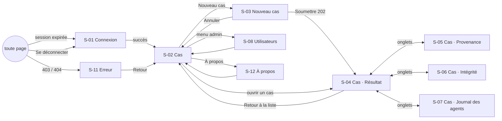
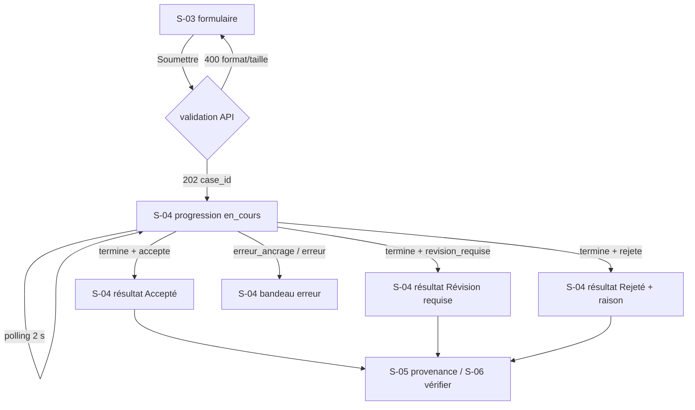

# SAAMSTIAHF — App Flow

| Owner | Status | Version | Last updated | Suite version | PRD | TRD | Schema | System Design | Designs |
|---|---|---|---|---|---|---|---|---|---|
| Équipe projet | In review | 2.0.2 | 2026-11-09 | 2.1.4 | [01-prd.md](01-prd.md) | [02-trd.md](02-trd.md) | [04-backend-schema.md](04-backend-schema.md) | [05-system-design.md](05-system-design.md) | [07-design-brief.md](07-design-brief.md) |

## 1. Périmètre et plateformes

Application web desktop (Chrome/Edge/Firefox ≥ 120, largeur ≥ 1280 px), en français. Une seule variante de flux. Le kit de démonstration (US-12) est un script CLI (`scripts/demo.py`, `scripts/tamper.py`), sans écran dédié ; il s'appuie sur S-04 et S-06. Le volet matériel (US-15 à US-17) n'a **aucun écran web** (D-11) : il se pilote en ligne de commande (`hw/host/coverify.py`, `hw/host/demo_step.py`) avec la carte Zybo Z7-10 branchée en USB ; ses parcours sont J-10 et J-11.

## 2. Rôles et accès

| Role | Can see | Can do | Signed-out behavior |
|---|---|---|---|
| Visiteur (non connecté) | S-01, S-12 | Se connecter | Toute autre URL → S-01, puis retour à l'URL demandée |
| operator | S-02 à S-07, S-12 | Créer un cas, consulter, vérifier | — |
| auditor | S-02, S-04 à S-07, S-12 | Consulter, vérifier ; **pas** de bouton « Nouveau cas » ; S-03 → S-11 (403) | — |
| admin | Tout, dont S-08 | Tout + gestion des utilisateurs (S-08) ; seuils et modèles via `scripts/registry.py` (hors interface, D-17) | — |

Source : matrice TRD §9 / Schema §10.

## 3. Diagramme de flux

### Vue d'ensemble

### J-01 — Analyser un nouveau cas (parcours principal)

## 4. Points d'entrée

| Entry point | Target screen | If signed out | If no access |
|---|---|---|---|
| `/` | S-02 | S-01 puis S-02 | — |
| `/cases/:caseRef` (lien partagé entre membres) | S-04 | S-01 puis S-04 | Cas inexistant → S-11 (404) |
| `/cases/:caseRef/provenance`, `/integrity`, `/logs` | S-05 / S-06 / S-07 | S-01 puis cible | 404 si cas inexistant |
| `/cases/new` | S-03 | S-01 puis S-03 | auditor → S-11 (403) |
| `/admin/users` | S-08 | S-01 puis cible | non-admin → S-11 (403) |
| Notifications push / e-mail / SMS | — | Aucune en v1 | — |
| Magasin d'applications / SEO | — | Sans objet (prototype local) | — |

## 5. Inventaire des écrans

| ID | Screen | Purpose | Roles | Required data (API / source) | Entry from | Exits to | Design |
|---|---|---|---|---|---|---|---|
| S-01 | Connexion `/login` | S'authentifier | public | `POST /auth/login` ; E-users, E-login_attempts | toute URL non authentifiée | S-02 ou URL demandée | DB §S-01 |
| S-02 | Liste des cas `/cases` | Voir les cas, filtrer, ouvrir, créer | tous | `GET /cases?page&size&status` ; E-cases (case_ref, created_at, status, predicted_class, confidence, decision) | S-01, menus, retours | S-03, S-04, S-08, S-12 | DB §S-02 |
| S-03 | Nouveau cas `/cases/new` | Téléverser ECG + rapport | operator, admin | `POST /cases` ; écrit E-cases, E-jobs | S-02 | S-04, S-02 | DB §S-03 |
| S-04 | Cas · Résultat `/cases/:caseRef` | Progression, tracé ECG, prédiction, validation, explication, résultat final, empreintes et tx_id | tous | `GET /cases/{id}` (E-cases, E-artifacts, artefacts prediction/validation/explanation/final_result déchiffrés) ; `GET /cases/{id}/signal` (artefact processed) | S-03, S-02, lien | S-05, S-06, S-07, S-02 | DB §S-04 |
| S-05 | Cas · Provenance `/cases/:caseRef/provenance` | Chaîne des artefacts lue sur Fabric | tous | `GET /cases/{id}/history` (E-ledger_artifact via GetCaseHistory) | S-04 (onglet) | S-04, S-06, S-07 | DB §S-05 |
| S-06 | Cas · Intégrité `/cases/:caseRef/integrity` | Lancer une vérification, voir les résultats et l'historique des vérifications | tous | `POST/GET /cases/{id}/verifications` ; E-verifications, E-verification_items | S-04 (onglet) | S-04, S-05, S-07 | DB §S-06 |
| S-07 | Cas · Journal des agents `/cases/:caseRef/logs` | Actions des agents pas à pas | tous | `GET /cases/{id}/agent-logs` ; E-agent_logs | S-04 (onglet) | S-04, S-05, S-06 | DB §S-07 |
| S-08 | Admin · Utilisateurs `/admin/users` | Créer, modifier rôle, désactiver, réinitialiser mot de passe | admin | `GET/POST/PATCH /admin/users` ; E-users | menu admin | S-02 | DB §S-08 |
| ~~S-09~~ | ~~Admin · Validation~~ — retiré v2.0.0 (D-17) : remplacé par `scripts/registry.py config new\|activate` | — | — | — | — | — | — |
| ~~S-10~~ | ~~Admin · Modèles~~ — retiré v2.0.0 (D-17) : remplacé par `scripts/registry.py model list\|activate` | — | — | — | — | — | — |
| S-11 | Erreur 403 / 404 | Expliquer et rediriger | tous | — | toute route | S-02 | DB §S-11 |
| S-12 | À propos `/about` | Avertissement « prototype », attribution PTB-XL, versions (logiciel, modèle actif) | public | `GET /health` (versions) | pied de page | S-02 ou S-01 | DB §S-12 |

## 6. Parcours de première utilisation

- Pas d'inscription : l'admin crée les comptes (S-08) et communique le mot de passe initial hors application.
- Première connexion (S-01) → S-02 avec état vide « Aucun cas pour l'instant » et bouton « Nouveau cas » (operator/admin) ou texte « Aucun cas à auditer » (auditor).
- **Étapes facultatives :** aucune. **Reprise :** sans objet. **Permissions OS :** aucune (le sélecteur de fichiers du navigateur n'en exige pas).

## 7. Parcours principal — J-01 Analyser un nouveau cas

1. S-02 → « Nouveau cas » → S-03.
2. S-03 : choisir le format (WFDB ou CSV), déposer les fichiers ECG ; si CSV, saisir la fréquence d'échantillonnage ; joindre un rapport `.txt` ou saisir le texte (facultatif) → « Lancer l'analyse ».
3. API 202 → redirection S-04 `/cases/CASE-…` ; état « en cours » avec une frise de 7 étapes (ingestion → finalisation), chaque étape passant à « ancrée ✓ » avec son empreinte courte et son tx_id dès son ancrage.
4. Statut terminal → S-04 affiche : bandeau de décision (Accepté pour le prototype / Révision requise / Rejeté) + mention « Prototype — pas un diagnostic médical » ; carte Prédiction (classe principale, confiance %, barres des 5 probabilités) ; carte Validation (R1–R5 : ok / échec / non applicable + valeur mesurée) ; carte Explication (≤ 5 phrases) ; tracé ECG 12 dérivations (artefact processed) ; tableau Traçabilité (7 lignes : type, empreinte, tx_id, horodatage, agent).
- **Succès observable :** S-04 montre `termine`, une décision, et 7 lignes de traçabilité toutes « ancrée » avec un tx_id.
- **Stories :** US-01, US-02, US-03, US-04, US-05, US-06, US-07, US-08, US-13. US-14 (P1) n'est pas planifiée en v1 (D-17).

## 8. Parcours alternatifs

| ID | Journey | Start | Steps | End state | Stories |
|---|---|---|---|---|---|
| J-02 | Auditer un cas | S-02 | Ouvrir un cas → onglet Provenance (S-05) → onglet Intégrité (S-06) → « Vérifier l'intégrité » | Tableau de 7 statuts (valide / modifié / manquant / non vérifiable) + entrée ajoutée à l'historique des vérifications | US-09, US-10 |
| J-03 | Connexion et session | S-01 | Saisir e-mail + mot de passe → S-02 ; expiration → refresh silencieux ; échec du refresh → S-01 | Connecté sur S-02 ou URL demandée | US-11 |
| J-04 | Démonstration de falsification | CLI | `demo.py` crée un cas PTB-XL fixé et attend la fin → l'équipe montre S-04 → `tamper.py --case … --artifact prediction` → S-06 « Vérifier l'intégrité » | S-06 : `prediction` = Modifié, 6 autres = Valide | US-12, US-10 |
| J-05 | Administration | S-08 | Créer un utilisateur / changer un rôle / désactiver ; seuils et modèles : `scripts/registry.py` sur la machine de démo (D-17) | Utilisateur à jour ; nouvelle config/modèle actif utilisé par les **prochains** cas | US-11, US-05, US-04 |
| J-06 | Rejet en cours de pipeline | S-04 en cours | Étape en échec (fichier illisible, modèle non vérifiable, intégrité) → étapes suivantes « non exécutée » → finalisation | S-04 : décision Rejeté + raison ; artefact final_result ancré | US-03 (AC-03.3), US-04 (AC-04.3), US-05 (AC-05.3), US-08 (AC-08.2) |
| J-07 | Échec d'ancrage | S-04 en cours | Fabric indisponible → 3 réessais → `erreur_ancrage` | S-04 : bandeau « Ancrage impossible », aucune décision affichée, étapes non ancrées marquées | US-07 (AC-07.4) |
| J-08 | Annuler la création | S-03 | « Annuler » (confirmation si des fichiers ont été choisis) | S-02, rien créé | US-01 |
| ~~J-09~~ | ~~Explication visuelle (P1)~~ — non planifiée en v1 (D-17) | — | — | — | US-14 |
| J-10 | Co-vérification matérielle | CLI (admin) | `export_hw_vectors.py --case CASE-…` → `coverify.py --target sim` puis `--target board` (carte programmée) → ouverture du rapport `hw/reports/…md` | Rapport : 7/7 empreintes et 12/12 dérivations « identique », VERSION et COEF_ID indiqués ; code de sortie 0 | US-15, US-16, US-17 |
| J-11 | Étape matérielle de la démo (étape 9) | Après J-04, S-05 ouvert sur le cas | `demo_step.py --case CASE-… --artifact prediction --lead II` → la console affiche l'empreinte calculée par la carte à côté de l'empreinte on-chain (mise en regard avec S-05) puis la comparaison de la dérivation filtrée | « IDENTIQUE » pour l'empreinte et la dérivation, en ≤ 15 s (NFR-20) | US-17 (AC-17.4) |

## 9. Parcours de retour

- Connexion → URL demandée, sinon S-02 (tri par date décroissante, filtres conservés en paramètres d'URL).
- Un cas encore `en_cours` rouvert reprend le polling ; le pipeline tourne côté serveur indépendamment du navigateur.

## 10. Spécifications des actions

### S-01 — Se connecter
| Aspect | Specification |
|---|---|
| Trigger | Bouton « Se connecter » ou Entrée |
| Validation | E-mail au bon format : « Adresse e-mail invalide. » ; champs requis : « Champ obligatoire. » |
| Loading state | Bouton désactivé + indicateur ; double soumission impossible |
| Success state | Jeton stocké en mémoire, cookie refresh posé → URL demandée ou S-02 |
| Error states | 401 : « E-mail ou mot de passe incorrect. » (message identique dans tous les cas) / 423 compte verrouillé : « Trop de tentatives. Réessayez dans 15 minutes. » / 403 compte désactivé : « Compte désactivé. Contactez un administrateur. » / 429 : « Trop de requêtes, patientez une minute. » / 5xx ou réseau : « Service indisponible. Réessayer. » |
| Timeout | 10 s → message réseau + bouton Réessayer |
| Offline | Bloqué, message réseau |
| Next screen | S-02 |
| Analytics | `login_succeeded` / `login_failed` (audit_events) |

### S-03 — Lancer l'analyse
| Aspect | Specification |
|---|---|
| Trigger | Bouton « Lancer l'analyse » |
| Validation (client puis API) | WFDB : exactement un `.hea` et un `.dat` de même nom : « Fournissez le fichier .hea et le fichier .dat d'un même enregistrement. » / CSV : 12 colonnes I, II, III, aVR, aVL, aVF, V1–V6 : « Le CSV doit contenir les 12 dérivations (I … V6). » ; fréquence 50–10 000 Hz : « Fréquence entre 50 et 10 000 Hz. » / total ≤ 20 Mo : « Taille maximale : 20 Mo. » / extension non autorisée : « Formats acceptés : .hea + .dat, .csv ; rapport : .txt. » / rapport ≤ 10 000 caractères : « Rapport trop long (10 000 caractères max). » / durée < 10 s (API) : « L'enregistrement doit durer au moins 10 secondes. » |
| Loading state | Barre de téléversement (%), formulaire verrouillé, bouton désactivé |
| Success state | 202 → S-04 du nouveau cas |
| Error states | Validation 400 : message par champ, fichiers conservés / Permission 403 : S-11 / Session expirée 401 après échec du refresh : S-01, fichiers perdus (message « Vos fichiers n'ont pas été envoyés. ») / 429 : « Limite de 10 analyses par minute atteinte. » / 5xx : « Échec de création du cas. Réessayer. » (fichiers conservés) |
| Timeout | 60 s de téléversement → message + Réessayer |
| Offline | Bloqué |
| Next screen | S-04 |
| Analytics | `case_created` |

### S-04 — Suivre la progression
| Aspect | Specification |
|---|---|
| Trigger | Ouverture de S-04 tant que `status ∈ {en_attente, en_cours}` |
| Loading state | Squelette au premier chargement ; ensuite frise de 7 étapes : à venir / en cours (animation) / ancrée ✓ / échec ✕ / non exécutée — |
| Success state | Statut terminal → arrêt du polling, affichage complet (§7) |
| Error states | Polling en erreur réseau : bandeau discret « Connexion perdue, nouvelle tentative… » et réessai à 2/4/8 s / 404 : S-11 / `erreur_ancrage` : bandeau rouge « Ancrage sur la blockchain impossible — résultat non émis. » / `erreur` : « Le traitement a échoué : {error_message} » |
| Timeout | Pipeline > 120 s : mention « Le traitement prend plus de temps que prévu. » (polling continue) |
| Offline | Polling suspendu, reprise au retour réseau |
| Next screen | — |
| Analytics | `pipeline_completed` (émis côté serveur) |

### S-05 — Charger la provenance
| Aspect | Specification |
|---|---|
| Trigger | Ouverture de l'onglet |
| Loading state | Squelette de la frise |
| Success state | Frise verticale parent → enfant (7 nœuds max) : type, horodatage (txTimestamp), empreinte (copiable), version logiciel/modèle, agent créateur (creatorAgent / creatorMspId), tx_id |
| Error states | Fabric injoignable (502) : « Registre blockchain injoignable — historique indisponible. Réessayer. » / cas encore en cours : nœuds disponibles + « Traitement en cours » |
| Timeout | 10 s → même message que 502 |
| Next screen | — |

### S-06 — Vérifier l'intégrité
| Aspect | Specification |
|---|---|
| Trigger | Bouton « Vérifier l'intégrité » (désactivé tant que le cas est `en_cours`) |
| Validation | Aucune saisie |
| Loading state | Bouton désactivé + « Vérification en cours… » (≤ 10 s attendu) |
| Success state | Tableau 7 lignes : type, statut (icône + libellé : Valide / Modifié / Manquant / Non vérifiable), empreinte on-chain, empreinte recalculée (différence surlignée), détail ; résumé « 6 valides, 1 modifié » ; ajout en tête de l'historique des vérifications (date, auteur, résumé) |
| Error states | Fabric injoignable : résultat enregistré avec tous les statuts « Non vérifiable » + bandeau explicatif (pas une erreur bloquante) / 5xx : « La vérification a échoué. Réessayer. » |
| Timeout | 30 s → message 5xx |
| Offline | Bloqué |
| Next screen | — |
| Analytics | `integrity_check_completed` |

### CLI — Co-vérification et étape de démo (J-10, J-11)
| Aspect | Specification |
|---|---|
| Trigger | `coverify.py --case CASE-… --target sim\|board` ; `demo_step.py --case CASE-… --artifact <type> --lead <dérivation>` |
| Validation | Cas inexistant ou vecteurs non exportés : « Vecteurs introuvables pour CASE-… — lancez export_hw_vectors.py. » ; dérivation inconnue : « Dérivation inconnue (attendu : I, II, III, aVR, aVL, aVF, V1–V6). » |
| Loading state | Barre de progression par vecteur ; `INFO` de la carte affiché d'abord (VERSION, COEF_ID) |
| Success state | Tableau console vecteur / attendu / obtenu / verdict ; ligne finale « IDENTIQUE (n/n) » ; rapport écrit |
| Error states | Carte injoignable (port série absent, pas de réponse à `INFO` en 3 s) : « Carte injoignable — vérifiez le câble USB et le démarrage SD. » + code de sortie 2, aucun verdict « identique » (AC-17.3) / CRC invalide : 3 réessais puis « Erreur de transmission » / COEF_ID de la carte ≠ `fir_coef_id` du cas : « Coefficients différents (carte : …, cas : …) » et FIR non comparé / Registre Fabric injoignable : empreintes on-chain « non vérifiables », verdict SHA non émis / Écart : verdict « DIFFÉRENT », code de sortie 1 |
| Timeout | 10 s par commande UART |
| Next | Rapport `hw/reports/` (J-10) ; retour à la présentation (J-11) |

### S-07 — Consulter le journal des agents
Lecture seule : tableau chronologique (heure, agent, étape, statut, durée, message) ; ligne dépliable pour `details` et ids d'artefacts entrée/sortie. Erreur réseau : « Impossible de charger le journal. Réessayer. »

### S-08 — Créer / modifier un utilisateur
| Aspect | Specification |
|---|---|
| Trigger | « Nouvel utilisateur » (modale) ou « Modifier » sur une ligne |
| Validation | E-mail valide et unique : « Cet e-mail est déjà utilisé. » ; nom 1–100 caractères ; mot de passe initial ≥ 12 caractères ; rôle requis |
| Loading state | Bouton désactivé |
| Success state | Modale fermée, ligne ajoutée/mise à jour, toast « Utilisateur enregistré. » |
| Error states | 400 par champ / 409 e-mail / 403 → S-11 / 5xx : toast + modale conservée |
| Règles | L'admin ne peut ni désactiver son propre compte ni retirer son propre rôle admin (bouton masqué + 400 côté API) |
| Analytics | `user_created` / `user_updated` |

### ~~S-09, S-10~~ — retirés v2.0.0 (D-17) ; CLI `scripts/registry.py`
| Aspect | Specification |
|---|---|
| Trigger | `registry.py config new --conf-high 0.7 --quality-min 0.9 --lexicon v1` ; `registry.py config activate <version>` ; `registry.py model list` ; `registry.py model activate <nom> <version>` |
| Validation | Seuils dans ]0 ; 1] : « Valeur entre 0 et 1. » ; modèle non ancré : « Ce modèle n'est pas enregistré sur la blockchain. » |
| Success state | Ligne « Version {n} active » ou « {nom} {version} actif » ; utilisée par les **prochains** cas |
| Error states | Base injoignable : « Base de données injoignable. » et code de sortie 2 |
| Analytics | `validation_config_created`, `model_activated` (audit_events) |

## 11. Règles de navigation

- **Structure :** barre supérieure (logo, « Cas », menu « Administration » pour admin, « À propos », utilisateur + « Se déconnecter ») ; S-04 à S-07 = un écran à 4 onglets avec URL distincte.
- **Retour :** bouton Précédent du navigateur suit l'historique des URLs ; S-03 avec fichiers sélectionnés → confirmation « Quitter sans lancer l'analyse ? » (`beforeunload` + garde de route).
- **Modales :** S-08 (utilisateur), confirmations ; fermeture par Échap, bouton Annuler ou clic extérieur (sauf pendant l'envoi).
- **Liens profonds :** cf. §4 ; `caseRef` = `CASE-<uuid>`.

## 12. États vides, chargement, blocage

| State | Where | What the user sees | Action offered |
|---|---|---|---|
| Chargement | S-02, S-04–S-08 | Squelettes | — |
| Aucune donnée | S-02 | « Aucun cas pour l'instant. » | operator/admin : « Nouveau cas » |
| Aucune donnée | S-06 | « Aucune vérification effectuée. » | « Vérifier l'intégrité » |
| Données partielles | S-04/S-05 cas en cours | Étapes terminées visibles, suivantes « à venir » | — |
| Cas rejeté tôt | S-04 | Cartes Prédiction/Explication « Non produite (pipeline arrêté à l'étape X) » | Onglet Journal |
| Hors ligne | partout | Bandeau « Hors connexion » | Réessai automatique |
| Permission refusée | S-03, S-08 | S-11 « Accès refusé : votre rôle ne permet pas cette action. » | Retour à la liste |
| Limité (429) | S-01, S-03 | Message §10 | Attendre |
| Compte désactivé / verrouillé | S-01 | Messages §10 | — |
| Registre injoignable | S-05, S-06 | Message §10 | Réessayer |

## 13. Sessions et interruptions

- Jeton d'accès expiré → refresh silencieux puis rejoue la requête ; refresh expiré (8 h) → S-01 avec retour à l'URL.
- Fichiers sélectionnés dans S-03 : perdus en cas de rechargement ou d'expiration de session (avertissement §10).
- Fermeture du navigateur pendant le traitement : sans effet sur le pipeline (serveur).
- Formulaires admin non enregistrés : confirmation avant de quitter la modale.

## 14. Notifications et retour

Aucune notification en v1 (polling sur S-04 uniquement).

## 15. Cycle de vie du compte

Création par l'admin (S-08) ; connexion (S-01) ; déconnexion (menu utilisateur → révocation du refresh, S-01) ; mot de passe oublié : texte « Contactez un administrateur » sur S-01, réinitialisation par l'admin dans S-08 ; désactivation par l'admin ; pas de suppression de compte (Schema §8), pas de paiement.

## 16. Actions destructives ou sensibles

| Action | Confirmation | Undo possible? | What is lost |
|---|---|---|---|
| Désactiver un utilisateur (S-08) | Modale « Désactiver {nom} ? Il ne pourra plus se connecter. » | Oui (réactiver) | Sessions en cours révoquées |
| Activer une version de seuils (`registry.py`, D-17) | Invite « Les prochains cas utiliseront la version {n}. Les cas existants ne changent pas. Confirmer ? [o/N] » | Oui (réactiver l'ancienne) | Rien |
| Activer un modèle (`registry.py`, D-17) | Invite « Les prochains cas utiliseront {nom} {version}. Confirmer ? [o/N] » | Oui | Rien |
| Quitter S-03 avec fichiers | Confirmation navigateur / modale | Non | Sélection de fichiers |
| Purge d'un cas | Hors interface (script admin, Schema §16) | Non | Données hors chaîne (empreintes on-chain conservées) |
| Falsification (démo) | Hors interface (`tamper.py`) | Restauration depuis sauvegarde | Fichier modifié |
| Export de vecteurs matériels | Hors interface (admin, `export_hw_vectors.py`) | Suppression du dossier d'export | Rien (copie déchiffrée temporaire, à supprimer après usage) |

## 17. Paramètres et aide

Pas de paramètres utilisateur. Administration : S-08 (utilisateurs) ; seuils et modèles en ligne de commande (`scripts/registry.py`). Aide : S-12 (avertissement, attribution PTB-XL CC BY 4.0, versions) et infobulles « ? » sur les règles R1–R5 et les statuts d'intégrité.

## 18. États système

- Un service en panne (`/health` rouge) : bandeau global « Service partiellement indisponible : {service}. »
- Correspondance avec les modes de défaillance du System Design §11 :

| FM | Où | Ce que voit l'utilisateur |
|---|---|---|
| FM-01, FM-13 | S-04 | « Ancrage sur la blockchain impossible — résultat non émis. » |
| FM-02 | S-06 | Bandeau + statuts « Non vérifiable » |
| FM-03 | S-05 | « Registre blockchain injoignable — historique indisponible. Réessayer. » |
| FM-04 | Partout | Bandeau global (ledger-gateway) + messages FM-01 à FM-03 |
| FM-05 | S-04 | « en cours » prolongé ; après 120 s : « Le traitement prend plus de temps que prévu. » |
| FM-06, FM-07 | S-01, S-04, autres | « Service indisponible. Réessayer. » ; S-04 : « Connexion perdue, nouvelle tentative… » ; bandeau global |
| FM-08 | S-06, S-04 | « Manquant » / « Modifié » ; pendant un job : décision « Rejeté » |
| FM-09 | S-04 | « Le traitement a échoué : {error_message} » |
| FM-10 | S-04 | Décision « Rejeté », raison « modèle non vérifiable » (J-06) |
| FM-11 | S-03 | Messages par champ (§10) |
| FM-12 | S-01 | Messages 423 / 429 (§10) |
| FM-14 à FM-17 | CLI matériel | Messages de la spécification CLI (§10) |
| FM-18 | — | Page d'erreur du navigateur (hors application) |
- Pas de mise à jour forcée ni de mode maintenance.
- F-17 (explication LLM, P2) désactivée : aucun élément d'UI affiché.

## 19. Accessibilité

Navigation clavier complète (ordre : barre supérieure → onglets → contenu) ; focus visible ; onglets en `role="tablist"` ; statuts toujours icône + texte (jamais la couleur seule, NFR-09) ; tracé ECG doté d'un résumé textuel (classe, FC) ; messages d'erreur liés aux champs (`aria-describedby`) ; progression annoncée via `aria-live="polite"`.

## 20. Textes clés `[draft copy]`

| State / message | Text | Owner |
|---|---|---|
| Mention résultat | « Prototype pédagogique — ce résultat n'est pas un diagnostic médical. » | Équipe |
| Accepté | « Accepté pour le prototype : tous les contrôles configurés sont satisfaits. » | Équipe |
| Révision requise | « Révision requise : {règles en échec}. » | Équipe |
| Rejeté | « Rejeté : {raison} (pipeline incomplet ou problème d'intégrité). » | Équipe |
| Valide | « Valide — l'empreinte recalculée correspond au registre. » | Équipe |
| Modifié | « Modifié — le fichier ne correspond plus à l'empreinte enregistrée sur la blockchain. » | Équipe |
| Manquant | « Manquant — le fichier hors chaîne est introuvable. » | Équipe |
| Non vérifiable | « Non vérifiable — aucun enregistrement blockchain accessible pour cet artefact. » | Équipe |
| CLI matériel : identique | « IDENTIQUE — la carte Zybo a recalculé exactement la même valeur. » | Équipe |
| CLI matériel : différent | « DIFFÉRENT — la valeur calculée par la carte ne correspond pas à la référence. » | Équipe |

## 21. Hypothèses

- Un seul écran de détail à onglets suffit pour la démo (pas de comparaison entre cas).
- Le polling 2 s est acceptable (ADR-11).
- Les comptes de démo sont créés par le seed (Schema §18).
- L'étape matérielle se présente dans un terminal projeté à côté de S-05 ; pas d'écran web dédié (D-11).

## 22. Questions ouvertes

Voir [review.md](review.md).
