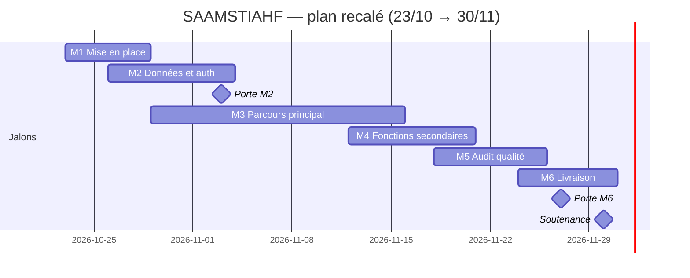

# SAAMSTIAHF — Plan d'implémentation

| Owner | Status | Version | Last updated | Suite version |
|---|---|---|---|---|
| Équipe projet | Approved scope (D-15) — plan recalé (D-17) | 2.0.1 | 2026-10-23 | 2.0.1 |

v2.0.0 : aucun développement n'a eu lieu entre le 2026-10-05 et le 2026-10-23 (AAR-01). Le plan est recalé sur 23/10 → 30/11, avec chevauchement des jalons, coupes D-17 et rééquilibrage des rôles (§3, §11).

## 1. Documents sources

| Document | Version | Fait foi sur |
|---|---|---|
| [01-prd.md](01-prd.md) | 2.0.1 | Périmètre, priorités, stories, critères d'acceptation |
| [02-trd.md](02-trd.md) | 2.0.1 | Stack, NFR, API publique, sécurité, environnements |
| [03-architecture.md](03-architecture.md) | 1.0.1 | Où va le code (SVC), règles de dépendance, interfaces (IF), propriété des données, ADR, contrats matériels (§5.6) |
| [04-backend-schema.md](04-backend-schema.md) + [schema.sql](schema.sql) | 2.0.1 | Données, contraintes, autorisations, enregistrements on-chain |
| [05-system-design.md](05-system-design.md) | 1.0.1 | Flux (DF), budgets de latence, modes de défaillance (FM), tests de charge et de pannes |
| [06-app-flow.md](06-app-flow.md) | 2.0.1 | Écrans, parcours, états, messages |
| [07-design-brief.md](07-design-brief.md) | 2.0.1 | Tokens, composants, rendu |
| [review.md](review.md) | 2.0.1 | Décisions (D-xx) — priment sur tout document plus ancien |
| [aar.md](aar.md) | 2.0.1 | Actions des AAR en cours |

En cas de conflit : décision D-xx > document propriétaire du sujet (tableau ci-dessus) > ce plan. Signaler le conflit dans `PROGRESS.md` (Issues) plutôt que trancher en silence.

## 2. Périmètre

- **Inclus (P0) :** F-01 à F-15 (US-01 à US-13) ; volet VHDL F-18 à F-20 (US-15 à US-17, D-10).
- **Coupé (D-17) :** F-16 / US-14 (saillance, P1) — T4.10 retirée ; écrans S-09/S-10 — remplacés par `scripts/registry.py` (T4.7) ; tests d'utilisabilité réduits à 2 testeurs (T5.6).
- **Non planifié :** F-17 (P2).
- **Exclu :** PRD §7.
- **Coupable si le retard dépasse 3 jours ouvrés à un checkpoint (dans l'ordre, décision utilisateur requise) :** T5.6 (tests d'utilisabilité) → T3.16b réduit à une dérivation affichée → polissage visuel des écrans S-05/S-07. Jamais coupable : tout ce qui sert le scénario CDC §9 et l'étape matérielle 9.
- **Repli matériel (décision utilisateur requise, pas automatique) :** si la carte devient indisponible, co-vérification N1 seule + vidéo de l'étape 9 enregistrée en M5.

## 3. Équipe et répartition

| Rôle | Domaine principal | Composants (Architecture §5) | Charge v2.0.0 |
|---|---|---|---|
| **L** — Ledger & matériel | Fabric, chaincode, passerelle, sécurité (M1–M2) ; VHDL, Zynq, carte, UART (spike M1, puis M3–M6) (D-12) | SVC-ledger-gateway, SVC-chaincode, SVC-hw-sha256, SVC-hw-fir, SVC-ps-app | ≈ 17,6 j |
| **I** — IA/données & DSP | PTB-XL, FIR + modèle bit-exact, préparation, modèle, agents IA, règles de validation, banc carte côté PC, bancs de charge et de pannes | SVC-dsp, SVC-registry, SVC-pipeline (agents), SVC-hw-host (carte) | ≈ 14,1 j |
| **B** — Backend | API, base, hachage, stockage, traçabilité, graphe LangGraph, vérification, contrôles d'architecture | SVC-api, SVC-identity, SVC-cases, SVC-traceability, SVC-verification, SVC-audit, SVC-hashing, SVC-ledger-client, SVC-hw-host (export, simulation) | ≈ 19,1 j |
| **F** — Frontend | React, design system, écrans admin et journal (y compris leurs endpoints), E2E, accessibilité | SVC-web | ≈ 13,6 j |

`[TBD: noms des 4 membres, Q-11 — en retard, action A-01.1]`. Chaque tâche a un responsable et un relecteur d'un autre rôle. Capacité disponible : ≈ 26 jours ouvrés du 23/10 au 30/11, soit ≈ 21 jours par personne à 4 jours par semaine.

## 4. Règles d'engagement des agents (et des humains)

Reprises dans [AGENTS.md](../../AGENTS.md).

- **À lire avant toute tâche :** `AGENTS.md`, `PROGRESS.md`, la tâche ci-dessous, les IDs listés dans « Entrées », les actions ouvertes de [aar.md](aar.md).
- **Conventions :** Python 3.11 (ruff, mypy strict sur `saam/hashing`, `saam/storage`), TypeScript strict, commits Conventional Commits avec l'ID de tâche, une branche par tâche `t3.4-upload-case` ; code placé dans le composant indiqué par l'Architecture §5.
- **Garde de périmètre :** ne construire que ce que la tâche et ses IDs demandent ; tout ajout → `PROGRESS.md` « Trouvé, non construit ».
- **S'arrêter et demander si :** un critère d'acceptation semble impossible ou contradictoire ; une modification de `schema.sql`, du chaincode (schéma on-chain), de la règle de hachage, du contrat arithmétique FIR ou des coefficients (`fir_coef_id`), des cartes de registres AXI ou du protocole UART (Architecture §5.6) est nécessaire ; une dépendance nouvelle non listée au TRD §18 ; une règle de dépendance de l'Architecture §6 devrait être enfreinte ; un test existant doit être supprimé ou affaibli ; une vérification échoue encore après 3 tentatives ; une action supprimerait des données ou réécrirait l'historique git ; une donnée non publique est en jeu.
- **Secrets :** jamais dans git (`.env`, wallet Fabric, `ARTIFACT_KEY`) ; uniquement `.env.example`.
- **Git :** PR relue par un autre membre ; CI verte obligatoire ; pas de push direct sur `main`.
- **AAR :** à chaque checkpoint de jalon, écrire l'AAR dans [aar.md](aar.md) avant de demander l'approbation, en commençant par les actions ouvertes de l'AAR précédent.

## 5. Commandes de vérification

| Objet | Commande |
|---|---|
| Installation | `uv sync && (cd frontend && npm ci)` |
| Lint Python | `uv run ruff check . && uv run mypy saam` |
| Contrôles d'architecture | `uv run lint-imports && uv run pytest tests/arch -q` |
| Tests Python | `uv run pytest -q` |
| Tests d'intégrité | `uv run pytest tests/integrity -q` |
| Migrations | `uv run alembic upgrade head && uv run alembic downgrade base && uv run alembic upgrade head` |
| Chaincode | `cd chaincode/provenance && npm test` |
| Gateway | `cd ledger-gateway && npm test` |
| Front | `cd frontend && npm run lint && npm test` |
| Réseau Fabric | `./fabric/network.sh up && ./fabric/deploy-chaincode.sh` |
| Pile complète | `docker compose up -d --build && curl -k https://localhost/api/v1/health` |
| Démo | `uv run python scripts/demo.py --record 00001` |
| E2E | `cd frontend && npx playwright test` |
| Modèle | `uv run python ml/evaluate.py --fold 10` |
| DSP (modèle bit-exact) | `uv run pytest tests/dsp -q` |
| Charge | `uv run python scripts/bench.py` |
| Injection de pannes | `uv run pytest tests/resilience -q` |
| Matériel N1 (simulation) | `make -C hw/sim` (GHDL + cocotb) |
| Build matériel | `vivado -mode batch -source hw/vivado/build.tcl` (poste L) |
| Matériel N2 (carte) | `uv run python hw/host/coverify.py --case CASE-… --target board` |

## 6. Spikes (risques d'abord, M1)

| ID | Question | Time box | Bloque | Responsable | Résultat |
|---|---|---|---|---|---|
| T1.3 | Peut-on lever test-network 2 orgs + canal `medtrace` + chaincode TS de démo sur les 4 postes ? | 1 j | T1.4, T2.5a | L | `[à remplir]` |
| T1.4 | Fabric CA émet-il des certificats avec attributs `role`, `agent` lisibles par le chaincode, et la gateway Node peut-elle signer avec plusieurs identités ? | 1 j | T2.5a, T2.6 | L | `[à remplir]` |
| T1.8 | Latence de 7 transactions séquentielles avec endossement `AND(Org1,Org2)` (seuil System Design DF-01 : ≤ 7,3 s par ancrage) | ½ j | T3.17, NFR-01 | L | `[à remplir]` |
| T1.9 | La Zybo Z7-10 démarre-t-elle un design PS + registre AXI4-Lite, depuis JTAG puis depuis la carte SD, et l'UART tient-il 921 600 bauds ? | 1 j | T3.21, T4.12 | L | `[à remplir]` |
| T1.10 | GHDL + cocotb tournent-ils en CI GitHub Actions ? | ½ j | T3.18, T3.19 | B | `[à remplir]` |
| T3.8a (anticipé M2) | Entraînement CPU du CNN 1D en temps raisonnable ? | 1 j | T3.8b | I | `[à remplir]` |

## 7. Jalons

| Jalon | Dates | Objectif | Preuve de sortie | Porte humaine |
|---|---|---|---|---|
| M1 Mise en place | 23/10 → 28/10 | Dépôt, CI, Fabric et carte qui tournent, données téléchargées | CI verte ; `/health` vert ; spikes consignés ; AAR-02 | — |
| M2 Données et auth | 26/10 → 03/11 | Schéma, auth + tests d'autorisation, chaincode complet, gateway, FIR + préparation | Migrations up/down ; tests d'autorisation et chaincode verts ; AAR-03 | **Oui** : encadrant, 2026-11-03 `[TBD: date à confirmer, Q-12]` |
| M3 Parcours principal | 29/10 → 15/11 | J-01 de bout en bout (tranche fine d'abord, modèle réel ensuite) ; cœurs VHDL en simulation | AC de US-01 à US-08 et US-13 verts de bout en bout ; N1 verte ; AAR-04 | — |
| M4 Fonctions secondaires | 12/11 → 20/11 | Provenance, vérification, admin utilisateurs, kit de démo, co-vérification carte | AC de US-09 à US-12 et US-15 à US-17 ; N2 verte ; AAR-05 | — |
| M5 Audit qualité | 18/11 → 25/11 | Tests intégrité, E2E, accessibilité, charge, pannes, utilisabilité, sauvegarde | Tests NFR verts (Annexe B) ; AAR-06 | — |
| M6 Livraison | 24/11 → 30/11 | Machine et carte de démo, rapport, répétitions, tag v1.0.0 | Critères PRD §16 cochés ; AAR-07 | **Oui** : encadrant, 2026-11-27 `[TBD: date à confirmer, Q-12]` ; soutenance 2026-11-30 |

## 8. Tâches

Taille : S ≤ ½ journée, M ≤ 1 journée, L ≤ 2 jours (à découper si plus).

### M1 — Mise en place

| ID | Resp. | Entrées | Sortie | DoD | Vérification | Dépend | Taille |
|---|---|---|---|---|---|---|---|
| T1.1 | B | TRD §5, §17, §18 | Monorepo (`saam/`, `chaincode/`, `ledger-gateway/`, `frontend/`, `fabric/`, `ml/`, `scripts/`, `tests/`), `pyproject.toml` (uv), `.env.example`, pre-commit, `AGENTS.md`, `PROGRESS.md` | Arborescence créée, lint vide passe | `uv run ruff check .` | — | S |
| T1.2 | B | TRD §17, D-06 | Workflow GitHub Actions (lint + tests Py/TS + build images) + protection de `main` | PR de test bloquée si test rouge | Exécution CI sur une PR | T1.1 | S |
| T1.3 | L | TRD §5, ADR-10 | `fabric/network.sh` (2 orgs, orderer Raft, CA, canal `medtrace`) | Réseau levé/détruit 3 fois de suite sur 2 postes | `./fabric/network.sh up && peer channel list` | T1.1 | M |
| T1.4 | L | ADR-02, ADR-09 | `fabric/enroll-identities.sh` (7 agents `role=pipeline-agent`, `verifier` Org2, `model-admin`) + gateway Node minimale | Une transaction de test signée par `agent-ingestion` ; chaincode lit l'attribut | `npm run spike:submit` | T1.3 | M |
| T1.5 | B | TRD §5, Architecture §10, NFR-11 | `docker-compose.yml` (postgres, api, worker, ledger-gateway, frontend/nginx TLS auto-signé) avec `/health` | 5 conteneurs sains ; mémoire de la pile + test-network consignée (System Design §17) | `docker compose up -d && curl -k https://localhost/api/v1/health` | T1.1 | M |
| T1.6 | I | ADR-08 (révisé), TRD §10 | `ml/data.py` : téléchargement PTB-XL v1.0.3 (`records500`), sommes de contrôle, chargement 500 Hz, folds 1–8/9/10, superclasses | Comptes par fold et par classe affichés | `uv run python ml/data.py --check` | T1.1 | S |
| T1.7 | F | DB §6–§8, §14 (C-top-nav) | Vite + React + TS + Tailwind avec tokens DB §6, polices auto-hébergées, C-top-nav, routes vides S-01…S-12 | Build OK, tokens appliqués | `npm run build` | T1.1 | S |
| T1.8 | L | NFR-01 | Mesure de latence 7 tx | Résultat dans `PROGRESS.md` (Décisions) | `npm run spike:latency` | T1.4 | S |
| T1.9 | L | TRD §3, §6.6 (Intégration Zynq), ADR-13, D-12 | Spike Zybo Z7-10 : fichiers de carte Digilent, `build.tcl` minimal (PS7 + 1 registre AXI4-Lite), application Vitis « hello » UART, `BOOT.bin` sur SD, essai 921 600 bauds | Registre écrit/relu depuis le PS ; démarrage SD ; débit UART consigné dans `PROGRESS.md` | `vivado -mode batch -source hw/vivado/build.tcl` + console série | T1.1 | M |
| T1.10 | B | ADR-12, AC-17.2 | `hw/sim/` (Makefile GHDL + cocotb) + job CI `hw-sim` | Job vert sur un module VHDL trivial ; bloque la PR si rouge | `make -C hw/sim` | T1.2 | S |
| T1.11 | B | Architecture §6, §8, §12, ADR-15, ADR-16, NFR-13 | Contrats import-linter (`pyproject.toml`), `tests/arch/` (propriété des tables, oracles cocotb), `tests/db/test_grants.py`, en CI | Un import interdit volontaire fait échouer la CI ; contrôles verts sur le squelette | `uv run lint-imports && uv run pytest tests/arch -q` | T1.2 | S |

**Checkpoint M1 (≤ 2026-10-28) :** réseau Fabric + compose + CI (dont `hw-sim` et contrôles d'architecture) fonctionnent sur ≥ 2 postes ; carte Zybo démarrée ; spikes consignés ; AAR-02 écrit.

### M2 — Données et authentification

| ID | Resp. | Entrées | Sortie | DoD | Vérification | Dépend | Taille |
|---|---|---|---|---|---|---|---|
| T2.1 | B | schema.sql, Schema §18 | Migration Alembic initiale | `alembic upgrade head` puis diff `pg_dump --schema-only` vs `schema.sql` vide | `uv run pytest tests/db/test_migration.py` | T1.5 | M |
| T2.2 | B | Schema §18 | `scripts/seed.py` (admin, operator, auditor, config v1) | Idempotent ; mots de passe depuis `.env` | `uv run python scripts/seed.py && uv run python scripts/seed.py` | T2.1 | S |
| T2.3 | B | US-11, TRD §9, Schema §9 | `/auth/login`, `/refresh`, `/logout`, `/me` ; Argon2id ; verrouillage 5/15 min ; 10 req/min/IP | AC-11.1, AC-11.3 testés | `uv run pytest tests/api/test_auth.py` | T2.1 | M |
| T2.4 | B | TRD §9, Schema §10, NFR-05 | Dépendance de rôle + test paramétré de toute la matrice | AC-11.2 ; chaque route couverte (test qui échoue si une route n'a pas de règle) | `uv run pytest tests/api/test_authz.py` | T2.3 | M |
| T2.5a | L | TRD §8.3, Schema §5.2 (E-ledger_artifact), AC-07.3, NFR-03, NFR-06 | `CreateArtifactRecord`, `GetArtifactRecord`, `GetCaseHistory`, événement | Tests : doublon refusé, parent absent refusé, champ inconnu refusé, sans attribut refusé, `creator*` issus du certificat | `cd chaincode/provenance && npm test` | T1.4 | L |
| T2.5b | L | Schema §5.2 (E-ledger_model), AC-04.3 | `RegisterModel`, `GetModel` | Tests : attribut `model-admin` requis, doublon refusé | `npm test` | T2.5a | S |
| T2.6 | L | TRD §8.2, ADR-02, ADR-09 | `ledger-gateway` Fastify : 5 routes, `X-Agent-Token` → identité, erreurs normalisées (409 doublon, 502 Fabric) | Tests d'intégration contre test-network | `cd ledger-gateway && npm test` | T2.5a | M |
| T2.7 | B | TRD §8.2, NFR-13 | `saam/ledger/client.py` (`LedgerClient`) | Tests de contrat contre la gateway | `uv run pytest tests/ledger` | T2.6 | S |
| T2.8 | F | S-01, S-11, App Flow §10 (S-01), §13 | Écran de connexion, garde de routes, refresh silencieux, retour à l'URL demandée, S-11 | J-03 manuel + tests composants | `npm test` | T1.7, T2.3 | M |
| T2.9 | L | NFR-03 | Test qui parcourt `GetCaseHistory` et refuse tout champ hors schéma / motif de type nom, date de naissance | Test vert sur données factices | `uv run pytest tests/integrity/test_no_phi_onchain.py` | T2.7 | S |
| T2.10 | I | US-16 (AC-16.1, AC-16.4), ADR-14, Architecture §5.6 (FIR), NFR-21 | `hw/gen/gen_fir_coeffs.py` (remez 111 coefficients, Q1.15) → `saam/dsp/fir_coeffs.json` + `fir_coef_id` + `hw/rtl/fir_coeffs_pkg.vhd` ; `saam/dsp/fir_fixed.py` (contrat arithmétique exact) | Gabarit respecté sur coefficients quantifiés ; saturation testée ; RSB ≥ cible NFR-21 (ou valeur mesurée + issue) ; régénération idempotente | `uv run pytest tests/dsp -q` | T1.1 | M |
| T2.11 | I | AC-16.2, Architecture §5.6 (Co-vérification) | 5 enregistrements PTB-XL `records500` du fold 10 copiés dans `hw/vectors/ptbxl/` (+ attribution CC BY 4.0) | Fichiers + README d'attribution versionnés | `uv run python ml/data.py --check-hw-vectors` | T1.6 | S |
| T2.12 | I | US-03 (AC-03.1, AC-03.2), Architecture §5.3 (préparation, étapes 2–6), ADR-08 révisé | `saam/dsp/prepare.py` : fonction de préparation signal pure (quantification, FIR bit-exact, alignement, passe-haut, z-score, qualité), partagée par l'agent et l'entraînement | Tests : PTB-XL `records500` → `fir_input` identique aux valeurs brutes ; formes [12,5000]/[12,1011]/[12,1000] | `uv run pytest tests/dsp/test_prepare.py` | T2.10 | M |

**Checkpoint M2 (porte humaine) :** tests d'autorisation et chaincode verts avec preuve (sortie CI) ; démonstration d'une transaction signée par agent ; validation de l'encadrant le 2026-11-03 `[TBD: date à confirmer, Q-12]` ; AAR-03 écrit.

### M3 — Parcours principal (J-01)

Ordre : tranche fine avec agents factices (T3.1–T3.5) → agents réels → interface.

| ID | Resp. | Entrées | Sortie | DoD | Vérification | Dépend | Taille |
|---|---|---|---|---|---|---|---|
| T3.1 | B | ADR-04, TRD §7.2, NFR-12 | `saam/hashing` : manifeste JCS, SHA-256, arrondi des flottants | Même artefact → même empreinte 100× ; test inter-OS en CI | `uv run pytest tests/hashing` | T1.1 | M |
| T3.2 | B | ADR-05, Schema §14, NFR-04 | `saam/storage` (`ArtifactStore`) AES-256-GCM, AAD | Fichier sur disque ≠ clair ; altération → exception dédiée | `uv run pytest tests/storage` | T1.1 | S |
| T3.3 | B | US-07 (AC-07.1, AC-07.3, AC-07.4), Schema §12, System Design §7 (ordre d'écriture), FM-13 | `TraceabilityTool.record` : écrire → ligne `artifacts` → ancrer (3 réessais) → `ancre` ; idempotence | Doublon même empreinte = succès ; Fabric arrêté → `erreur_ancrage` | `uv run pytest tests/pipeline/test_traceability.py` | T3.1, T3.2, T2.7 | M |
| T3.4 | B | US-01 (AC-01.1–01.3), Schema §11, App Flow §10 (S-03) | `POST /cases` multipart, validations, création cas + job + audit dans une transaction | Messages d'erreur App Flow ; 403 auditor | `uv run pytest tests/api/test_cases_create.py` | T2.4 | M |
| T3.5 | B | US-08, ADR-03, Architecture §5.2, §11 | Worker : prise de job SKIP LOCKED, graphe LangGraph à 7 nœuds factices, checkpoints Postgres, `agent_logs`, heartbeat, rejet → finalisation | Un cas factice produit 7 artefacts ancrés ; un nœud qui lève → résultat « Rejeté » ancré (AC-08.2) ; AC-08.3 | `uv run pytest tests/pipeline/test_graph.py` | T3.3, T3.4 | M |
| T3.6 | I | US-02 (AC-02.1–02.3), Architecture §5.3 | Agent `ingestion` : WFDB/CSV, pseudonymisation en-tête et rapport | Fixtures avec nom/date de naissance → absents des fichiers stockés | `uv run pytest tests/agents/test_ingestion.py` | T3.5 | M |
| T3.7 | I | US-03 (AC-03.1–03.3), Architecture §5.3, Schema §5.3 (processed) | Agent `preparation` (enveloppe de `saam/dsp/prepare.py`) + `fir_input.npy`, `fir_stage.npy`, `signal.npy`, `processing_report.json` (`fir_coef_id`) | Fichier illisible → rejet ; 15 % de NaN → qualité insuffisante ; 4 fichiers présents dans le manifeste | `uv run pytest tests/agents/test_preparation.py` | T3.6, T2.12 | M |
| T3.8a | I | ADR-08 (révisé) | `ml/train.py` (CNN 1D, folds 1–8/9) sur `records500` préparés par `prepare.py` (cache) | Une époque tourne ; pertes décroissantes | `uv run python ml/train.py --epochs 1` | T1.6, T2.12 | M |
| T3.8b | I | ADR-08, PRD §5 (AUC) | Poids `ecg-cnn1d` 1.0.0 + `ml/evaluate.py` + `model_card.json` | AUC macro fold 10 ≥ 0,85 (D-09), sinon repli ADR-08 et issue ouverte | `uv run python ml/evaluate.py --fold 10` | T3.8a | L |
| T3.9 | I | AC-04.3, Schema §5.1 (models) | `scripts/register_model.py` : empreinte des poids, `RegisterModel`, ligne `models` active | Modèle actif avec `registered_tx_id` | `uv run python scripts/register_model.py --check` | T3.8b, T2.5b | S |
| T3.10 | I | US-04 (AC-04.1, AC-04.3), Architecture §5.3 | Agents `features` et `prediction` (vérif. empreinte du modèle) | Poids altérés → rejet « modèle non vérifiable » | `uv run pytest tests/agents/test_prediction.py` | T3.7, T3.9 | M |
| T3.11 | I | US-05 (AC-05.1–05.4), US-13 (AC-13.1–13.2), Architecture §5.4, D-08 | Agent `validation` R1–R5 + `config/lexicon.yaml` FR/DE/EN (rapports PTB-XL allemands et textes FR saisis) | Tableau de cas de test par règle et par décision | `uv run pytest tests/agents/test_validation.py` | T3.10 | M |
| T3.12 | I | US-06 (AC-06.1–06.2), AC-08.2 | Agents `explanation` (gabarit FR) et `finalization` | ≤ 5 phrases ; mention prototype ; chemins de rejet | `uv run pytest tests/agents/test_final.py` | T3.11 | M |
| T3.13 | B | TRD §8.1, App Flow §5 (S-02, S-04) | `GET /cases`, `/cases/{id}`, `/cases/{id}/signal` (décimé) | Réponse ≤ 300 ms p95 en local (NFR-15) | `uv run pytest tests/api/test_cases_read.py` | T3.5 | M |
| T3.14 | F | S-02, DB §19 (S-02), C-table, C-status-badge, C-hash | Liste paginée + filtres + état vide | Tests composants ; auditor sans bouton « Nouveau cas » | `npm test` | T2.8, T3.13 | M |
| T3.15 | F | S-03, App Flow §10 (S-03), C-file-drop, C-textarea | Formulaire de création, validations client, barre d'envoi, garde de sortie | Tous les messages App Flow reproduits | `npm test` | T3.4, T3.14 | M |
| T3.16a | F | S-04, App Flow §10 (S-04), C-pipeline-stepper, C-banner, C-probability-bars, C-rule-list | Écran Résultat : polling 2 s, frise, décision, cartes, tableau de traçabilité | États en cours / terminé / rejet / erreur_ancrage | `npm test` | T3.13 | L |
| T3.16b | F | DB §18, C-ecg-viewer | Tracé 12 dérivations, grille papier | Rendu < 1 s ; résumé accessible | `npm test` | T3.16a | M |
| T3.17 | B | NFR-01, US-07 (AC-07.2) | Test d'intégration : 5 enregistrements fold 10 → 7 artefacts ancrés chacun | p95 ≤ 60 s (DF-01) ; manifestes avec versions modèle, logiciel, config, `fir_coef_id` (NFR-07) | `uv run pytest tests/integration/test_pipeline.py` | T3.12 | S |
| T3.18 | L | US-15 (AC-15.1, AC-15.2), Architecture §5.6 (SHA-256), ADR-12 | `hw/rtl/sha256_core.vhd`, `sha256_padder.vhd` + `hw/sim/test_sha256.py` (FIPS 180-4, 1 000 messages aléatoires à graine fixe dont longueurs 55/56/63/64/119/120) | 100 % identiques à `hashlib` | `make -C hw/sim TEST=sha256` | T1.10 | L |
| T3.19 | L | US-16 (AC-16.2, AC-16.4), Architecture §5.6 (FIR) | `hw/rtl/fir_decim.vhd` (+ paquet généré) + `hw/sim/test_fir.py` (int16 aléatoires, extrêmes, 5 enregistrements `hw/vectors/ptbxl/`) | Sortie bit-exacte vs `fir_fixed.py` | `make -C hw/sim TEST=fir` | T2.10, T2.11, T1.10 | L |
| T3.20 | L | Architecture §5.6 (cartes de registres), ADR-13 | `sha256_axi.vhd`, `fir_axi.vhd` + tests cocotbext-axi | Accès registres conformes aux tableaux de l'Architecture §5.6 ; mêmes vecteurs que T3.18/T3.19 via AXI | `make -C hw/sim TEST=axi` | T3.18, T3.19 | M |
| T3.21 | L | NFR-17, NFR-18, NFR-19, Architecture §5.6 (Intégration Zynq) | `hw/vivado/build.tcl` complet (PS7 + 2 IP, FCLK0 100 MHz) → bitstream, XSA, rapports utilisation/timing dans `hw/reports/` | WNS ≥ 0 à 100 MHz ; ressources consignées vs NFR-18 | `vivado -mode batch -source hw/vivado/build.tcl` | T3.20, T1.9 | M |
| T3.22 | B | US-17 (AC-17.1, AC-17.2), Schema §14 (volet matériel), Architecture §5.6 (Co-vérification) | `scripts/export_hw_vectors.py` (admin) + `hw/host/coverify.py --target sim` (rejoue les vecteurs d'un cas en cocotb) + rapport Markdown/JSON | Rapport complet sur un cas du pipeline ; export ignoré par git | `uv run python hw/host/coverify.py --case CASE-… --target sim` | T3.17, T3.20 | M |

**Checkpoint M3 (≤ 2026-11-15) :** J-01 joué depuis l'interface sur 3 enregistrements ; co-vérification N1 verte en CI (SHA-256, FIR, AXI) ; rapport de timing ; captures dans `PROGRESS.md` ; AAR-04 écrit.

### M4 — Fonctions secondaires

| ID | Resp. | Entrées | Sortie | DoD | Vérification | Dépend | Taille |
|---|---|---|---|---|---|---|---|
| T4.1 | B | US-10 (AC-10.1–10.3), Architecture §5.5, Schema (E-verifications) | Vérificateur (4 statuts) + `POST/GET /cases/{id}/verifications` ; utilisé aussi par R5 | Les 4 statuts produits par des fixtures | `uv run pytest tests/verify` | T3.12 | M |
| T4.2 | B | US-09 (AC-09.1–09.2) | `GET /cases/{id}/history` (Fabric) | 404 si cas inconnu ; 502 si Fabric arrêté | `uv run pytest tests/api/test_history.py` | T2.7 | S |
| T4.3 | F | S-05, C-provenance-timeline | Écran Provenance | État Fabric injoignable | `npm test` | T4.2 | M |
| T4.4 | F | S-06, App Flow §10 (S-06) | Écran Intégrité | Ligne « Modifié » lisible de loin (DB §19) | `npm test` | T4.1 | M |
| T4.5 | F | S-07, AC-08.3 | `GET /cases/{id}/agent-logs` + écran Journal | Lignes dépliables | `npm test && uv run pytest tests/api/test_logs.py` | T3.5 | S |
| T4.6 | F | US-11, S-08, App Flow §10 (S-08) | `/admin/users` + écran | Règles d'auto-protection admin | `uv run pytest tests/api/test_admin_users.py && npm test` | T2.4 | M |
| T4.7 | B | US-05, US-04, IF-12, Schema (validation_configs, models), App Flow §10 (CLI registry), D-17 | `scripts/registry.py` (config new/activate, model list/activate) via SVC-registry ; remplace S-09/S-10 | Nouvelle version utilisée par le cas suivant uniquement ; modèle non ancré refusé ; invites de confirmation App Flow §16 | `uv run pytest tests/scripts/test_registry.py` | T3.11, T3.9 | S |
| T4.8 | B | US-12 (AC-12.1), J-04 | `scripts/demo.py`, `scripts/tamper.py` (modes octet brut et ré-chiffrement) | Scénario rejoué 3× sans intervention | `uv run python scripts/demo.py --record 00001 --tamper prediction` | T4.1 | S |
| T4.9 | F | S-12, TRD §8.1 (`/health`) | Écran À propos + versions | Attribution PTB-XL présente | `npm test` | T1.7 | S |
| ~~T4.10~~ | — | US-14 (P1), F-16 | Retirée v2.0.0 (D-17) | — | — | — | — |
| T4.11 | B | PRD §11, Schema (audit_events) | Émission des 6 événements PRD §11 enregistrés en base (`hw_coverification_completed` est écrit dans les rapports, T3.22) | Chaque événement présent après un scénario de démo | `uv run pytest tests/api/test_events.py` | T4.1 | S |
| T4.12 | L | Architecture §5.6 (Intégration Zynq, protocole UART), ADR-13 | `hw/ps_app/` (Vitis bare-metal : trames, CRC-32, commandes INFO/SHA256/FIR, pilotes des 2 IP) + `hw/host/zybo_client.py` (les deux côtés du protocole) + `BOOT.bin` | INFO renvoie VERSION/COEF_ID ; « abc » → condensat FIPS sur carte ; CRC invalide rejeté | `uv run pytest hw/host/tests -m board` | T3.21 | M |
| T4.13 | I | US-17 (AC-17.3, AC-17.4), J-10, J-11, App Flow (CLI), DB (sortie console), NFR-20 | `coverify.py --target board` + `hw/host/demo_step.py` (sortie console du Design Brief) | Carte débranchée → code 2, aucun « identique » ; étape 9 ≤ 15 s | `uv run python hw/host/demo_step.py --case CASE-… --artifact prediction --lead II` | T4.12, T3.22 | S |
| T4.14 | L | US-15 (AC-15.3, AC-15.4), US-16 (AC-16.3), NFR-16 | Co-vérification N2 sur le cas de démo `demo.py --record 00001` → `hw/reports/<date>-board-<cas>.md` | 7/7 empreintes et 12/12 dérivations identiques ; manifeste modifié → « DIFFÉRENT » | `uv run python hw/host/coverify.py --case CASE-… --target board` | T4.13, T4.8 | S |

**Checkpoint M4 (≤ 2026-11-20) :** AC de US-09 à US-12 et US-15 à US-17 vérifiés ; N2 verte (rapport `hw/reports/`) ; AAR-05 écrit.

### M5 — Audit qualité

| ID | Resp. | Entrées | Sortie | DoD | Vérification | Dépend | Taille |
|---|---|---|---|---|---|---|---|
| T5.1 | B | AC-12.2, NFR-08, TRD §16 | `tests/integrity` (tout valide, octet modifié, re-chiffré altéré, supprimé, absent on-chain, Fabric arrêté) | 6/6 verts | `uv run pytest tests/integrity -q` | T4.8 | S |
| T5.2 | F | J-01, J-02, J-04 | Playwright | 3 parcours verts | `npx playwright test` | T4.4 | M |
| T5.3 | F | NFR-09, NFR-10, DB §20, App Flow §20 | Audit axe + corrections + relecture des textes | 0 violation serious/critical ; textes conformes à l'App Flow §20 (NFR-10) | `npx playwright test a11y` | T5.2 | M |
| T5.4 | I | NFR-01, NFR-02, NFR-15, NFR-20, System Design §14 (charge) | `scripts/bench.py` sur la machine de démo | Valeurs consignées vs budgets DF-01 à DF-05 ; cibles tenues ou issue ouverte | `uv run python scripts/bench.py` | T3.17, T4.1 | S |
| T5.5 | L | TRD §12 | Revue sécurité (OWASP, secrets, NFR-03, privilèges DB) | Checklist remplie, issues corrigées | `uv run pytest tests/integrity/test_no_phi_onchain.py && pip-audit && npm audit` | T4.11 | S |
| T5.6 | F | DB §1, §23 | Tests utilisateurs (2 testeurs, 3 tâches, D-17) | Résultats vs objectifs DB §1 | Compte rendu dans `PROGRESS.md` | T5.2 | S |
| T5.7 | B | TRD §14, System Design §12, Schema §16 | `scripts/backup.sh`, `scripts/restore.sh` (Postgres, volume, Fabric ensemble) + `scripts/purge_case.py` | Restauration réussie en ≤ 30 min (RTO), démo rejouée après ; cas purgé → artefacts `manquant` à la vérification | `scripts/backup.sh && scripts/restore.sh` | T4.8 | S |
| T5.8 | L | NFR-16, NFR-17, NFR-18, NFR-19, NFR-20 | Régression matérielle : rebuild depuis un clone propre, N1 + N2 complets, mesures timing/ressources/durée étape 9 consignées pour le rapport | Tous critères tenus ou issue ouverte avec décision | `make -C hw/sim && uv run python hw/host/coverify.py --case CASE-… --target board` | T4.14 | S |
| T5.9 | I | System Design §11, §14 (FM-01, FM-04, FM-05, FM-06), NFR-11, App Flow §18 | `tests/resilience/` (arrêt de l'orderer, de la passerelle, du `worker`, de PostgreSQL) + `scripts/reanchor.py`, `scripts/requeue.py` | Chaque FM affiche le message App Flow attendu puis revient à l'état normal ; aucun double ancrage ; cas `erreur_ancrage` terminé par `reanchor.py` | `uv run pytest tests/resilience -q` | T4.8, T4.1 | M |

**Checkpoint M5 (≤ 2026-11-25) :** tests NFR de l'Annexe B verts ou issues décidées ; restauration répétée ; AAR-06 écrit.

### M6 — Livraison

| ID | Resp. | Entrées | Sortie | DoD | Vérification | Dépend | Taille |
|---|---|---|---|---|---|---|---|
| T6.1 | L | TRD §17, Q-03 | Machine de démo : images pré-tirées, fonctionnement hors ligne | Démo complète réseau coupé | `scripts/demo.py` hors ligne | T5.7 | S |
| T6.2 | Tous | CDC §12, PRD §17 | Rapport final court (dont chapitre matériel : architecture, ressources, timing, co-vérification) + README + diaporama | Relu par 2 membres | Revue | T5.4, T5.8 | L |
| T6.3 | Tous | CDC §9, D-13 | 2 répétitions chronométrées du scénario, étape matérielle 9 incluse | 9/9 étapes réussies | Grille de répétition | T6.1, T6.5 | S |
| T6.5 | L | D-13, PRD §14 (risque carte) | Carte de démo prête : `BOOT.bin` final sur SD (+ SD de secours), vidéo de secours de l'étape 9 | Démarrage SD sans PC Vivado ; vidéo lisible hors ligne | `uv run python hw/host/demo_step.py --case CASE-… --artifact prediction --lead II` | T5.8 | S |
| T6.4 | B | PRD §16, CDC §12 | Tag `v1.0.0`, checklist des 10 livrables | Checklist complète | `git tag -l v1.0.0` | T6.3 | S |

**Checkpoint M6 (porte humaine, 2026-11-27) :** critères de lancement PRD §16 cochés avec preuves ; AAR-07 écrit ; validation de l'encadrant avant la soutenance du 2026-11-30.

## 9. Checklist de checkpoint (chaque jalon)

- [ ] Commandes de vérification du jalon vertes, sortie jointe à `PROGRESS.md`.
- [ ] Critères d'acceptation des stories du jalon vérifiés un par un.
- [ ] `PROGRESS.md` à jour (Done, Décisions, Issues, Trouvé-non-construit).
- [ ] Écarts aux specs consignés dans `docs/specs/review.md` et cascade lancée si nécessaire.
- [ ] AAR écrit dans [aar.md](aar.md) (actions de l'AAR précédent vérifiées d'abord ; chaque action a un responsable et une échéance).
- [ ] Porte humaine (M2, M6) : approbation notée avec date.

## 10. Retour arrière par jalon

| Jalon | Retour arrière |
|---|---|
| M1 | `network.sh down` + suppression des volumes |
| M2 | `alembic downgrade base` ; redéploiement du chaincode à la séquence précédente (`--sequence n-1` impossible : nouvelle version corrective) |
| M3–M4 | revert de la PR ; données de dev jetables (re-seed + réseau recréé) |
| M5–M6 | tag précédent + `restore.sh` |
| Matériel (tous jalons) | bitstream / XSA / `BOOT.bin` de la release précédente (pièces jointes GitHub) ; un changement de coefficients impose une nouvelle `fir_coef_id` et la ré-exécution des cas de démo |

## 11. Calendrier

| Rôle | Charge (j) | Capacité 23/10 → 30/11 à 4 j/semaine (j) | Marge |
|---|---|---|---|
| L | 17,6 | ≈ 21 | ≈ 3,4 |
| I | 14,1 | ≈ 21 | ≈ 6,9 |
| B | 19,1 | ≈ 21 | ≈ 1,9 |
| F | 13,6 | ≈ 21 | ≈ 7,4 |

Charge = somme des tailles (S = ½ j, M = 1 j, L = 2 j) ; tâches partagées réparties à parts égales. La marge de B est la plus faible : I et F reprennent en priorité ses tâches en cas de retard (T4.11 → F, T5.1 → I).

## 12. Risques

Voir PRD §14, TRD §22 et System Design §18. Spécifiques au plan : (1) départ tardif de 18 jours (AAR-01) → jalons chevauchants, aucune marge de calendrier hors des coupes listées au §2 ; (2) charge du rôle L en M1–M2 (Fabric + spike Zybo T1.9) → B l'assiste sur T1.5/T2.6 si retard ; L porte ensuite ≈ 10 jours de matériel en M3–M6, compensé par l'absence de tâches Fabric après M2 ; (3) marge de B ≈ 2 jours (§11) → reprises prévues par I et F ; (4) entraînement (T3.8b) sur le chemin critique de T3.10 → agents factices jusqu'à mi-M3, repli scikit-learn (ADR-08) si AUC indisponible au 2026-11-12 ; points de contrôle hebdomadaires de la charge à chaque AAR.

## 13. Hypothèses

- ≈ 4 jours de travail par membre et par semaine du 2026-10-23 au 2026-11-30 (≈ 21 jours par personne).
- Dépôt GitHub + Actions (D-06).
- Carte Zybo Z7-10 appartenant à l'équipe, accessible au membre L dès M1 et le jour de la soutenance (D-14) ; Vivado/Vitis ≥ 2023.1 sur son poste (D-12).

## 14. Questions ouvertes

Voir [review.md](review.md).

## Annexe A — Couverture des stories

| Story | Tâches |
|---|---|
| US-01 | T3.4, T3.15 |
| US-02 | T3.6 |
| US-03 | T2.10, T2.12, T3.7 |
| US-04 | T3.8a, T3.8b, T3.9, T3.10, T3.16a, T4.7 |
| US-05 | T3.11, T3.16a, T4.7 |
| US-06 | T3.12, T3.16a |
| US-07 | T2.5a, T2.6, T2.7, T3.1, T3.2, T3.3, T3.16a, T3.17 |
| US-08 | T3.5, T4.5 |
| US-09 | T4.2, T4.3 |
| US-10 | T4.1, T4.4, T5.1 |
| US-11 | T2.3, T2.4, T2.8, T4.6 |
| US-12 | T4.8, T5.1 |
| US-13 | T3.11 |
| ~~US-14 (P1)~~ | Non planifiée en v1 (D-17) |
| US-15 | T1.9, T3.18, T3.20, T3.21, T4.12, T4.14, T5.8 |
| US-16 | T2.10, T2.11, T3.19, T3.20, T3.21, T4.12, T4.14, T5.8 |
| US-17 | T1.10, T3.22, T4.13, T5.8, T6.3, T6.5 |

## Annexe B — Couverture des NFR par des tests

| NFR | Tâches de test | Preuve System Design |
|---|---|---|
| NFR-01 | T3.17, T5.4 | DF-01 |
| NFR-02 | T5.4 | DF-02 |
| NFR-03 | T2.9, T5.5 | — |
| NFR-04 | T3.2 | — |
| NFR-05 | T2.4 | — |
| NFR-06 | T2.5a | — |
| NFR-07 | T3.17 | — |
| NFR-08 | T5.1 | FM-08 |
| NFR-09 | T5.3 | — |
| NFR-10 | T5.3 | — |
| NFR-11 | T1.5, T5.9 | FM-04, FM-06, FM-07 |
| NFR-12 | T3.1 | — |
| NFR-13 | T1.11 | — |
| NFR-14 | T3.5 | — |
| NFR-15 | T3.13, T5.4 | DF-03 |
| NFR-16 | T3.18–T3.20, T4.14, T5.8 | DF-06 |
| NFR-17 | T3.21, T5.8 | — |
| NFR-18 | T3.21 | — |
| NFR-19 | T5.8 | — |
| NFR-20 | T4.13, T5.4, T5.8 | DF-05 |
| NFR-21 | T2.10 | — |
